<div align="center">

<h1></h1>

### AI 争辩。代码结算。连亏损都摆在明面上。

[](https://pypi.org/project/clawock/)
[](https://www.npmjs.com/package/clawock-dsh)
[](https://github.com/KCNyu/clawock/actions/workflows/ci.yml)
[](https://github.com/KCNyu/clawock/actions/workflows/dashboard-artifact-gate.yml)
[](https://github.com/KCNyu/clawock/actions/workflows/ci.yml)
[](LICENSE)

[**实时仪表盘**](https://kcnyu.github.io/clawock/) &nbsp;·&nbsp; [**每日简报**](https://kcnyu.github.io/clawock/briefs.html) &nbsp;·&nbsp; [**证据与反证**](https://kcnyu.github.io/clawock/#reflect) &nbsp;·&nbsp; [**English**](README.md)

<a href="https://kcnyu.github.io/clawock/">
  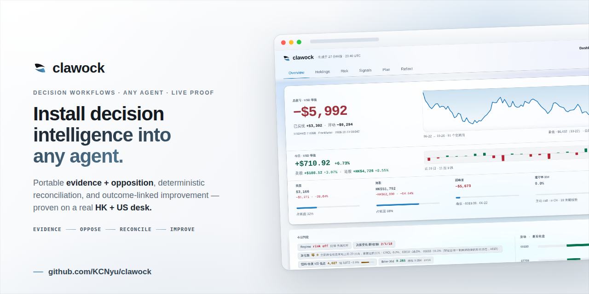
</a>

<sub><i>“市场不在乎模型有多自信。”</i></sub>

<a href="https://kcnyu.github.io/clawock/">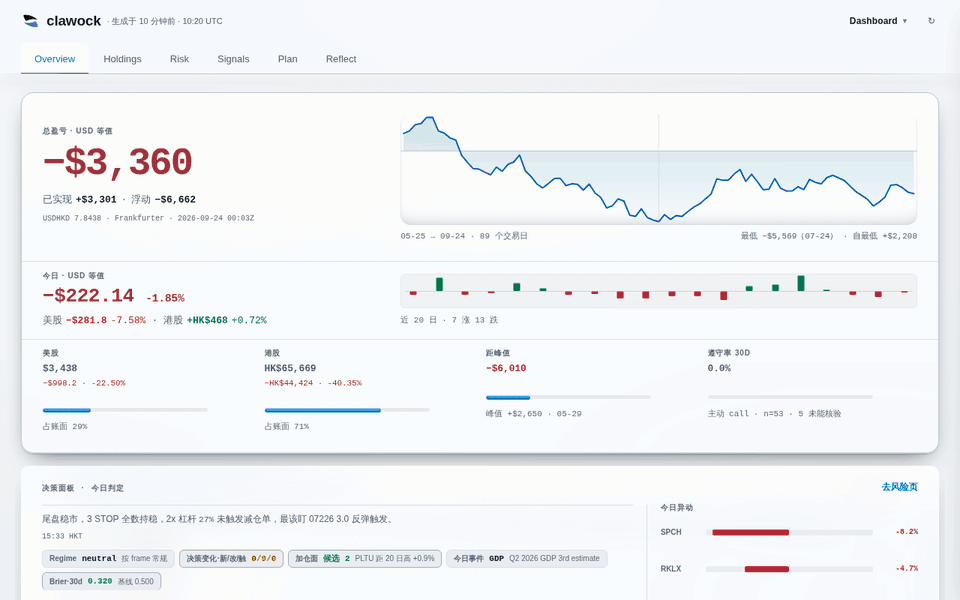</a>

<a href="https://kcnyu.github.io/clawock/#drill"><picture><source media="(max-width: 700px)" srcset="site/assets/books-narrow.svg"></picture></a>

| **<!-- CW_M:days -->148<!-- /CW_M:days -->** | **<!-- CW_M:rows -->1013<!-- /CW_M:rows -->** | **<!-- CW_M:settled -->166<!-- /CW_M:settled -->** | **47** | **5** | **0** |
|:---:|:---:|:---:|:---:|:---:|:---:|
| 天,真实港美股账户实盘 | 条决策,账本全部公开 | 个案例由代码结算 | 8 层抓取与计算模块 | 种 Agent harness,同一份契约 | 条分数由模型给自己打 |

<sub>真实持仓、真实盈亏,亏损照样摆出来([原始决策记录](https://github.com/KCNyu/clawock/blob/master/memory/decisions.jsonl))。数字与图每周刷新;实时仪表盘随交易日更新。</sub>

</div>

## 你能得到什么

clawock 帮你的 AI Agent 分析港股或美股持仓、写出买卖计划。作者每天早上收到的计划会说明买、卖还是继续等，支持和反对的理由，以及哪些价位会改变建议。**下单的是你。** 之后，程序按行情核对这些判断，把结果留给 Agent 下次参考。

<p align="center"></p>

**这个循环，就是这里说的 RSI（Recursive Self-Improvement，递归自我改进）。** 作者的每日任务依赖已接好的数据源、定时运行配置和积累的决策历史。新用户需要接入自己的数据、设置排程，也可以先跑[单次示例](#五分钟跑起来)。保存以前的证据和结果，让 Agent 在下次判断前有据可查。**它不承诺收益。** 那些叫作者「动手」的建议，还没有证明自己比抛硬币强。

这一页用一次真实判断说明整个过程：2026-10-08 早上的金风科技（`02208`，港股）。计划是继续持有观察，站上 8.97 才加仓。到下一个交易日收盘，股价下跌，账本因此记为 `loss`：评的是继续持有的判断，没有假定按 8.97 买入。下面几节分别说明证据、计划和计分方式。

计划里的指标由[插件](#能算的都是插件结果能做什么不是)计算。策略可以[搜索更好的设置](#策略可以搜索自己的参数采纳是一次要-review-的改动)，但采纳前需要人工审核。[五分钟跑起来](#五分钟跑起来)。

## 能算的都是插件；结果能做什么不是

2026-10-08，作者持有 400 股金风科技（`02208`，港股），平均成本 14.084。下面是指标如何进入计划、判断如何得到评估的过程。插件负责计算指标，`config/strategy-plugins.json` 指定使用哪些模块及其设置。

1. **`factors` 插件用金风的每日行情计算指标。** 结果显示没有上升趋势，股价在 200 日均线下方 31.8%。
2. **模型结合指标和其他证据写出多空理由。** 多方：同业里只有金风给出可以执行的确认价，组合也缺少港股科技与 AI 以外的持仓。空方：趋势弱，组合已越过四条风控线，都不支持加仓。结论是先观察，在价格到达前记下触发条件。
3. **计划具体到可以被证明是错的。** 观察；五个交易日内站上 8.97 才动手；跌到 8.923 这个想法作废。信心 0.34。
4. **代码评估继续持有的判断。** 参考价 8.645，是计划发布后第一个能成交的价格。下一个交易日收盘比它低了 4.22%，因此结果记为 `loss`。这条记录没有假定按加仓触发价买入。
5. **判断和结果留在记录里。** 公开账本上的 `dec-6d9e8bdc8817` 会计入下一份简报读取的历史记录。

<p align="center"></p>

**你可以替换第 1 步的插件。** 自己的插件可以换用另一条均线、观察期或数据源。第 4、5 步的结算和记账不由插件控制：插件不能给自己的判断打分、挑选参考价、改结果或把判断排除在账本之外。因此，不同策略可以按同一套计分规则比较。

接入自己的 Agent 时，你需要一个 skill、一个命令行工具和一套交换决策的 JSON 文件格式。模型、对话和工具仍归你的 Agent。

**插件必须说明输入和输出。** 结果进入决策前，插件必须声明数据来源、单位、观察期和缺数据时的处理方式，不能把昨天的结果当成今天的。

| 插件 | 计算什么 | 缺数据时 |
|---|---|---|
| `factors` | 用每日行情计算每只股票的趋势、动量、RSI、波动与离场价 | 该字段为空；日线不足 30 根时，不提供这只股票的计算结果 |
| `bar-signals` | 每个交易日里，一只股票的交易成本有多高、接下来可能动多大 | 留空，绝不写 0：「估不出来」不等于「交易成本低」 |
| `sentiment` | 七天内的 Reddit 提及数，以及点名公众人物的言论 | 整段省略，并写明扫描是缺失、过期还是读不了 |
| `morning-scans` | 宏观快照与中文资讯，并且是每个定时扫描文件的唯一读取处 | 同上：省略，并给出原因 |
| `strategy-scores` | 每个标的在每个研究策略当前设定下排第几；仅作参考 | 写明未取到及原因 |

**插件加载失败时，依赖它的任务会停下并报出插件名，其余任务照常运行。**

**你可以编写自己的插件。** 在配置文件里登记已安装的 Python 模块；接口与必填声明见[插件编写指南](docs/architecture/strategy-plugins.md#writing-a-plugin-outside-this-repository)。插件以你的权限运行，不在沙箱内，因此只安装你信任的模块。

**其他插件运行时，你可以添加、移除插件或修改设置。** 移除插件会暂停依赖它的插件，恢复后自动重启；修改设置会让该插件按新配置重启。这沿用了 [dsh](examples/dsh/README.md) 的插件设计。

<p align="center"></p>

```bash
clawock strategy-lab list       # 插件、提供的服务和缺少的依赖
clawock strategy-lab sources    # 输入、单位、观察期和缺数据时的处理方式
```

[插件配置与权限边界](docs/architecture/strategy-plugins.md) · [编写自己的插件](docs/architecture/strategy-plugins.md#writing-a-plugin-outside-this-repository)。

## 任何 harness，同一套会积累的决策契约

假设你今天用 Claude Code，下个月换成 Codex。你不用从头再来，因为 clawock 从来就不在聊天窗口里。它是一个 skill（`investment-decision`）、一个命令行工具，加上工作区里的几个文件。只要 Agent 能读文件、写文件、跑命令，就能接着用：**Claude Code / Codex / OpenClaw / DeepSeek Harness / 你自己的脚本**。

属于 Agent 的东西还是它的：模型、对话、记忆、研究工具、你的凭证和权限。clawock 从不启动模型。它只在你的 Agent 周围做四件事：把输入固定下来，检查输出，过后给结果打分，把记录留住。

接入自己的 Agent 时，你会用到 `request.json`、`decision.json`、`outcome.json` 和 `evaluation.json`。作者的每日实盘另外写入 `plan.json` 和 `decisions.jsonl`。

| 文件 | 谁写的 | 里面是什么 |
|---|---|---|
| `request.json` | clawock，在你运行 `clawock run prepare` 时 | 这次判断用的材料，每份文档都带指纹，事后换不掉 |
| `decision.json` | 你的 Agent | 它的回答：看多的理由、看空的理由、动作，以及什么情况说明它错了 |
| `plan.json` | 作者的实盘，每天早上 | 同样的回答，但覆盖整个组合，每只持仓一条 |
| `decisions.jsonl` | 作者的实盘 | 公开账本：一次判断一行，代码结算后把结果补在这一行上 |
| `outcome.json` | 你，等观察期过了之后 | 你看到的价格，以及价格是从哪里来的 |
| `evaluation.json` | clawock，在你运行 `clawock workflow evaluate` 时 | 方向对不对。不是赚了多少钱 |

**写下一份计划前，Agent 可以回看以前怎么判断、结果怎样。** 模型本身没有变。文件保存证据、实际动作和结果；积累足够的评估记录后，作者的配置还会核对以前给出的信心有多可靠。换 Agent 时保留同一个工作区，就能继续使用这些历史。新工作区没有你的决策历史，需要逐次记录判断、等观察期结束后评估，才能积累起来。

<p align="center"></p>

[通用调用与反馈协议](docs/architecture/runtime-protocol.md#evaluate-and-improve-without-owning-the-agent) · [工作流的改进边界](docs/architecture/harness.md#ownership).

## 信息进来：先有来源，再有观点

2026-10-08，08:03。早上的任务刚启动，还没有任何模型开始跑。Python 已经从腾讯取回了金风的日线，找过公司公告，也向 Google 新闻要了它的标题。回来四条。两条和金风毫无关系。另外两条是上一个收盘之前发的，于是被标成旧闻。一手财务披露没有取到。

简报在 `02208` 下面照实写了两行。一行说，一手财务披露「未取到」。另一行说：「这只票今天没有可用消息证据，所以它今天的判断完全来自价格与相对强弱。」

这一节的标题说的就是这条规矩：**先把来源收齐、标清楚，然后才轮到观点。** 落到实处是三个做法：

- **每个来源都有后备。** 行情先走腾讯或 Nasdaq，一家取不到就换下一家。公告来自 SEC 和港交所，资金流来自东财，另有中英文新闻、宏观数据和情绪。然后 Python 把你的账本、汇率和风险数字核对一遍。
- **旧闻不会被当成新消息。** 上一个收盘之前发布的内容，都标成旧闻。
- **没取到就写「未取到」，不写「没有消息」。** 港股的基础覆盖是齐的，但**研究广度落后美股**。

**你的 Agent 拿到的是一包文件。** 在作者的实盘上，`preflight` 写出这次判断必需的文件，外加 Agent 想多看时可以再打开的参考文件。金风那次判断到现在还带着它所用那包材料的编号 `c3f65a7beaebb24e`，谁都能查到它背后是哪一批资料。在你自己的 harness 里，`clawock run prepare` 写出 `request.json`：同样的一包材料，每份文档和整包各有一个 SHA-256 指纹，并记下它对应的工作流版本。

**指纹证明的是「用了哪些材料」，不证明新闻是真的。** 每条引用都带来源，以及发布时间或观察时间。数据源的密码和模型的 API key 留在你自己的运行时里，不进公开仓库。在你自己的 harness 里，Agent 还可以用它自己的研究工具补充证据，只要查得到出处。作者的定时任务只读 Python 装配好的文件。

**实盘完整信息流与投递路径**

<p align="center"></p>

[信息层与来源目录](docs/how-the-desk-works.zh.md#信息层) · [认证协议](docs/architecture/runtime-protocol.md).

## 决策出来：多空同读一份证据

那天早上的问题很简单：金风现在该不该加仓？Agent 不能凭感觉回答。它必须先写看多的理由，再写最有力的反方理由，然后才能给出动作、触发价、信心数字，以及什么情况下它认错。多空两边读的是同一包文件。

作者的 08:03 简报设定：站上 8.97 才加仓，五个交易日内有效，失效价为 8.923。盘中卡片用最新行情核对触发条件。金风当天最高到 8.71，因此当天没有触发加仓。已有持仓的「继续持有」判断，仍按下面的口径单独计分。

**你拿到的是一份计划和一张回执。** 作者的实盘每天留下简报和 `plan.json`。在你自己的 harness 里，Agent 写出 `decision.json`，你运行 `clawock run publish`。这时 Python 检查四件事：每个论断都指向那包材料里的某份文档；有反方理由；写明了什么情况算判断错了；订单和汇率的算术对得上。四件都过，你拿到一张和那包材料绑定的回执。缺了反方理由，就拒绝发布。在作者的实盘上，对话里得出的结论用 `clawock record --source <harness>` 记进账本。不管走哪条路，下不下单由你决定。

<p align="center">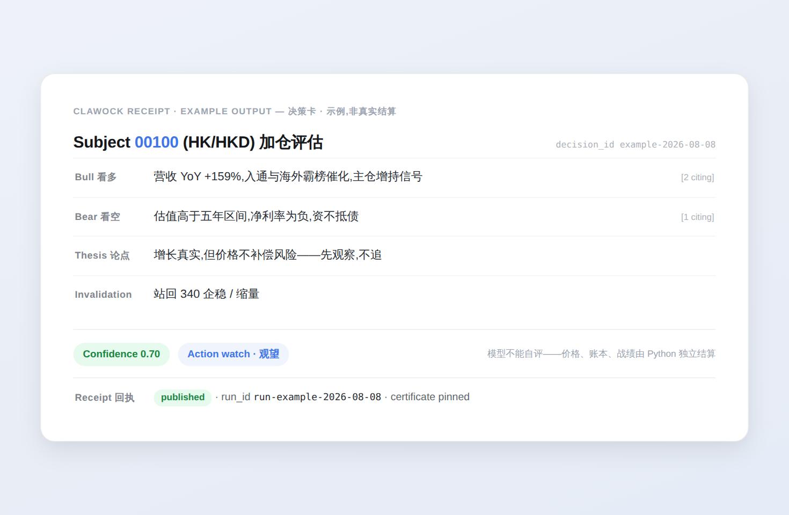</p>

<sub>示例输出，不是真实结算。</sub>

**实盘完整多空辩论**

<p align="center"></p>

在作者的实盘上，这场辩论由几个角色分头完成：四位分析师，一多一空两位研究员，三位风险官，还有一位裁判；裁判要写明每条结论用的是哪套策略。这套辩论改编自 [TradingAgents](https://github.com/TauricResearch/TradingAgents)。在你自己的 harness 里，你现有的那一个 Agent 也要满足同样两条：读同一份证据，写出反方理由。

## 收盘后：结果回到下一次判断

对 2026-10-08 的金风记录，代码评的是「继续持有」这个判断在下一个交易日对不对。参考价取计划发布后第一个能成交的价格 8.645；下一个交易日收在 8.28，低了 4.22%，所以结果记为 `loss`。这条记录的动作是 `watch`，评估方式是 `passive_stance`，并注明 `fill_assumed: false`，没有假定按 8.97 的触发价买入。这里是持有判断的方向评分，不是一笔新交易的盈亏。

这个分数靠三条规矩才算数，每条背后都有一个真实的例子：

- **每天说同一句话，只算一次。** 从 2026-07-29 到 2026-10-08，简报对金风说了 45 次「持有观察」。它们归成一个结果（`ep-f31982c6d511`），不是 45 个。
- **打不了分的判断也留在账上。** 2026-10-01 的计划给金风设了触发价，但那天港股休市。记录 `dec-143614125e34` 的结果未定（`outcome: unknown`），评估状态是无法评估（`status: not_evaluable`），场次原因单独记录（`session_reason: market_closed`）。
- **你做了什么，和计划说了什么，分开记。** `clawock mark-followed` 给每条判断标上「跟了」或「没跟」，因为账户的成绩是模型的建议加上你自己的选择。

价格只认同一套标准日线，并且按各个市场自己的交易日历来读。

**下一次判断从这份记录开始。** 2026-10-12 的简报在「昨日兑现（2026-10-08 的 plan）」这张表里，又把金风这次判断印了一遍，旁边写着 `loss`。同一份简报里，裁判对金风写的是：不动，十天后有三季报，猜方向不如等公告。模型还会读到它以前给的信心数字到底准不准。这项核对只用更早日期的数据；例子太少时，就少信这个数字一点，或者干脆不给读数。判断错了的那一条，仍然连着它当时依据的证据，所以 Agent 可以回头复核昨天的理由，而不是每天把故事从头讲一遍。

**在自己的 harness 里评估判断时，** 等观察期结束，把价格和来源写入 `outcome.json`，再运行 `clawock workflow evaluate`，生成核对判断方向的 `evaluation.json`。它不计算实际成交的盈亏。

评估结果或被拒绝的发布，可以用来支持修改证据要求的提案。审核者的姓名和决定会留在记录里，通过后才能应用，也可以回滚。这个流程只允许调整所需证据条数、没有一手来源时的信心上限，不能修改策略、买卖规则或 skill 本身。审核和回滚步骤见[反馈协议](docs/architecture/runtime-protocol.md#evaluate-and-improve-without-owning-the-agent)。

<p align="center"></p>

每条判断都按这套规则结算并公开：赢的、输的、无法评估的都保留，不在事后人为调整结果。

<p align="center">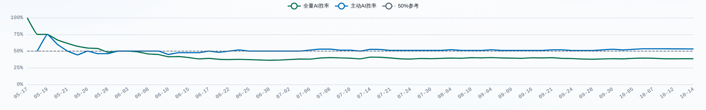</p>

<sub>累计案例胜率对 50% 方向命中基线:衡量方向对了多少次,不是赚了多少。每周刷新;实时数字在<a href="https://kcnyu.github.io/clawock/#drill">持仓页</a>。</sub>

读这些结果时，请留意四条限制：

- **量的是方向，不是钱。** 图表统计方向判断的命中率，不是收益。模型不能给自己打分，也不代表行情数据和计分定义一定正确。
- **主动建议尚未证明比抛硬币强。** 估计区间仍包含 50% 的信号不会进入决策；杠杆刻度盘的择时能力也无法与随机区分。两项结果都公开在 [Reflect](https://kcnyu.github.io/clawock/#reflect)。
- **影子组合是模拟，不是实盘。** 主要指标不含佣金和买卖价差，旁边另列按预设成本扣减的结果。两者都没有模拟大单对价格的影响。
- **账户成绩包含人的选择。** 由账户所有者决定是否跟随建议，每条判断分别记录已跟随、未跟随或未知。

有账本数据时，你可以复核计算。`clawock scorecard-provenance --check` 从 `memory/decisions.jsonl` 重算公开的主要指标，`clawock audit-resettle` 重新结算账本。
[打分规则如何处理特殊情况](docs/how-the-desk-works.zh.md#战绩怎么打分硬规则) · [测了什么、什么没通过](docs/how-the-desk-works.zh.md#测了什么什么没通过)。

一份提案不只看它赚没赚。2026-10-12，模型提出：MiniMax（`00100`）一个交易日内站上 225 就减 20 股；同时预测，第五个交易日收在 213 下方的概率是 0.55。代码把这份提案（`prop-7c966b4a33172e8c`）连同它当时用的输入、它自己写明的方法和两条异议一起存了下来。之后它被分开读两次：这笔交易赚没赚；0.55 这个概率给得准不准。[方法评估](https://github.com/KCNyu/clawock/blob/master/docs/architecture/decision-architecture.md#method-records-and-evaluation)两样都报，而且得分高的方法不会被自动采用。

**从开放提案，到可核对的方法证据**

<p align="center"></p>

## 策略可以搜索自己的参数；采纳是一次要 review 的改动

金风的指标里有 RSI，用来衡量近期价格的涨跌强弱。`rsi` 插件的配置是回看 14 个交易日，把低值视为可能反弹。作者的策略实验室在每日简报后运行，测试其他设置。2026-10-12 的搜索使用了有行情历史的 28 只股票，包括金风。

1. **只试事先声明过的设置。** 插件配置提前列出六种回看长度和两种读法，十二种组合全部计数，不能把碰巧好看的结果说成唯一试过的一组。
2. **一道闸来判其中最好的那组。** 它要求：有足够多没被拿来调参的交易日；排序结果胜过随机，并且比现在的设定好出的幅度不是噪声；被过去的数据「凑」出来的可能性够低；行情做过拆股与分红的复权。配置里可以把这道闸调严，但不能调得比代码里的下限更松。
3. **第二意见可以反对。** 另外几组阈值会判同一次运行，比如扣掉交易成本之后再看。它们能拦，但不能放行闸已经拒掉的东西。
4. **结论记下来。** 每次运行都进台账，台账每次被读取时都会按这些规则再核一遍。
5. **然后它得继续管用。** 过闸的设定会被登记，此后只在「选出它时还没发生」的交易日上计分。

<p align="center"></p>

2026-10-12，RSI 的答案是：回看 28 个交易日、读成「强者恒强」，对这些名字的排序会更好。闸放行了它，它被登记。**只用行情源确认已复权的 16 个名字（金风在内）重跑同一搜索，结论是拒绝。** 这个结果靠的是另外 12 个名字，而实验室对它们只有一个依据：单一行情源的记录里没有拆股或分红，没有第二个来源可以对照。现在每次运行都带着这次重跑，过闸的设定自己会说明它经不经得起。

**这次搜索没有改变金风的 RSI 设置。** 下一份简报仍用 14 个交易日和反弹读法。采纳新设置需要审核配置改动；实验室只有在候选设置经受至少 60 个后续交易日的检验、并通过目前未过的检查后，才能提出修改。截至 2026-10-12 这次运行，还没有后续交易日计分，也没有修改提案。

```bash
clawock strategy-lab evolution rsi   # 每次运行、变了什么、每条登记及其之后的表现
clawock strategy-lab row-edits       # 待审核的配置修改提案
clawock strategy-lab verify          # 拿台账对照实验室的边界
```

[一次搜索能得出什么结论、第二意见与实验室的边界](docs/architecture/strategy-plugins.md#boundaries)。

## 模型不被允许做的事

模型负责写观点。算术不归它，给自己打分也不归它；这两样都在 Python 里，有单元测试钉着。放到金风那个早上，就是模型做不了下面这些事：

- **自己挑参考价。** 8.645 是代码里一条规则定的：计划发布之后第一个能成交的价格。
- **给自己的判断打分。** `loss` 是结算代码照着日线写下的。写计划的那个模型碰不到这个字段。
- **没有反方理由就发布。** 缺了反方证据的判断会被拒收，[五分钟跑起来](#五分钟跑起来)里有这个例子。
- **把港币和美元直接相加。** 金风以港币计价。两种货币并排显示，带上汇率和取汇率的时间，不会被直接加在一起。
- **决定风控线有没有被越过。** 每份简报都由代码检查这些线。那天早上它查出四条仓位线、两条杠杆止损被越过，简报一开头写的就是这件事。每次越线都留有带日期的记录，写明当时怎么处置：减仓，或者继续持有并写下理由。任何一条都不会自己去卖出。

这些风控线、越线之后怎么处置、对证据的要求，都画在页首全景图里「Code holds the boundary」那一格。

[全部 12 条,代码具体做什么](docs/how-the-desk-works.zh.md#代码强制执行的规矩)。

## Harness 界面与后台工作

**DeepSeek Harness 的实盘视图与后台队列**

**交代任务，离开聊天，回来收结果。** 你在 dsh 网页端的聊天里交代一件仓库改动，并写明要怎么交付。后台的一个 Agent（Claude Code、Codex 或 OpenCode）接手，你关掉页面它也继续干。等你回来，面板上能看到它做到了哪一步。

这就是 `clawock-dsh` 给 dsh 加的东西：投资决策 skill、Decision Mind 标签页和 provider 面板。后台队列需要主机上装有 clawock 的 **agent-dispatch** runner。runner 负责让每个任务独立跑完，插件负责让你看得见、改得了方向。

<p align="center"></p>

- **看清正在发生什么。** 订阅用量与重置时刻、provider 余额、各 agent 的真实队列、模型、用时和按 API 标价估算的费用,都在同一块面板。
- **任务在跑,也能改方向。** 把排队任务往前移,在允许时改下一次尝试的模型,调整截止时间与重试预算,取消任务或续跑未完成的会话。
- **结果留得住。** 任务完成但消息发送失败仍然看得见;没收到消息不等于工作消失了。

作者的主机用同一条队列维护自己的代码（页首全景图里「The desk fixes itself the same way」那一格）。巡检轮次核查已经发布出去的东西。提报闸只为拿得出证据的发现开 issue。后台 Agent 带着修复走完 PR 和必需的 CI。被当作噪音关掉的 issue，会让同类发现下次的分量变轻。

**完整队列截图** —— 真实主机上的插件

<br>

<p align="center">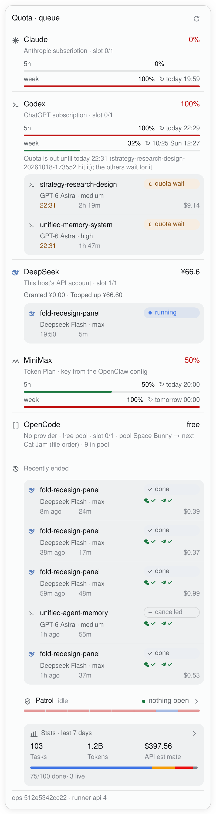</p>

[队列能力与配置](examples/dsh/packages/clawock-dsh/README.md#dispatch-queue) · [runner 与 ops 契约](docs/architecture/task-queue.md)。

**单个任务的历史** — 追加指令与进展时间线

<br>

<p align="center">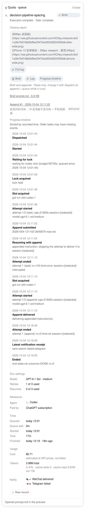</p>

问一句「0700.HK 能不能加点仓？」，投资 skill 会带着 Agent 走一遍上面那几步：收集证据，多空各写一遍，再写出带触发价和认错条件的决定。**Decision Mind** 是用来回头看的：点开一笔真实成交，顺着**计划 → 执行 → T+1 → 盈亏**看下去，也就是计划当时怎么说、你实际怎么做、一个交易日后价格在哪、最后是赚是亏。背后没有计划的成交会明说，还没判定的也会明说。USD 与 HKD 分开，下单仍由你来。

<p align="center">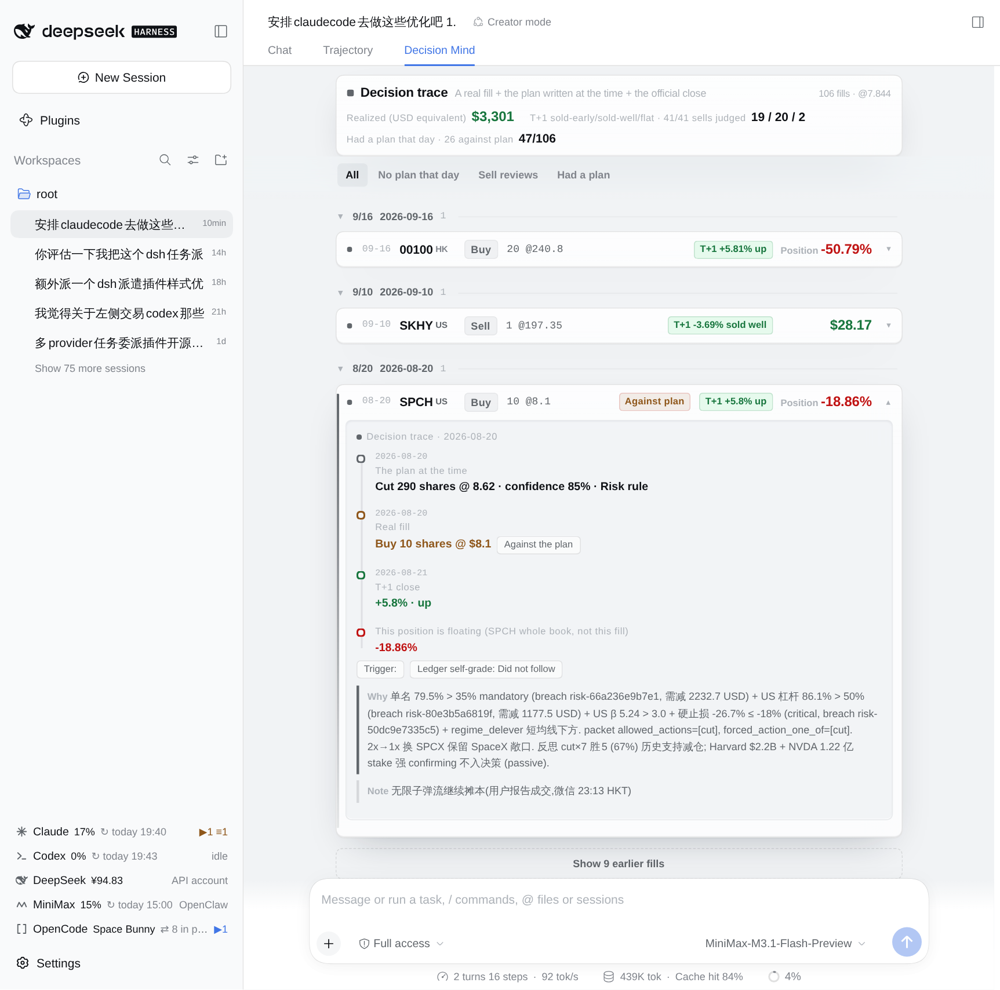</p>

```bash
python -m pip install clawock
dsh plugin --profile web add clawock-dsh
mkdir -p ~/.dsh/skills
cp -r ~/.dsh/profiles/web/node_modules/clawock-dsh/skills/investment-decision ~/.dsh/skills/
```

重启 web profile 后加载。后台队列控制还需要主机上的 runner;没装时面板仍显示 provider 额度与余额。[npm 包](https://www.npmjs.com/package/clawock-dsh) · [安装与队列配置](examples/dsh/packages/clawock-dsh/README.md)。

## 引擎盖下面

上面说的这一切，在作者的真实账户上每天是这样跑的：

<p align="center"></p>

<p align="center"></p>

作者的盘前计划在 **08:03 HKT** 发出，没有人守着，定时由 OpenClaw 来跑。每个任务都是三步：`clawock … preflight` 备好文件，模型写，`clawock … postflight` 检查并发布它写的东西：

<p align="center"></p>

<sub>由 <code>site/tools/shoot_openclaw_cron.js</code> 从主机真实的 <code>openclaw cron list --json</code> 渲染;任务 id、投递目标与 prompt 不出图。完整时刻表见<a href="docs/operations/cron-schedules.md">生成的排程表</a>。</sub>

[投研台怎么运转](docs/how-the-desk-works.zh.md)有信息层、运行上下文、结算细则与代码闸的完整说明。

## 五分钟跑起来

选你正在用的 Agent,点 logo 打开对应 harness 的可运行示例:

<div align="center">
<table>
<tr>
<td align="center" valign="top" width="120"><a href="examples/claude-code/CLAUDE.md"><br><b>Claude Code</b></a></td>
<td align="center" valign="top" width="120"><a href="examples/codex/AGENTS.md"><br><b>Codex</b></a></td>
<td align="center" valign="top" width="120"><a href="examples/openclaw/SKILL.md"><br><b>OpenClaw</b></a></td>
<td align="center" valign="top" width="120"><a href="examples/dsh/README.md"><br><b>DeepSeek Harness</b></a></td>
<td align="center" valign="top" width="120"><a href="examples/cli/run.sh">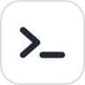<br><b>自己的 / 纯 CLI</b></a></td>
</tr>
</table>
</div>

**最省事的办法:** 把本仓库地址丢给你的 Agent,让它 `python -m pip install clawock` 后跑 `bash examples/cli/minimal-run/run.sh`。不需要模型,也不需要任何 API 密钥,看到 `isolated run published <run_id>` 就是第一张被 Python 校验过的决策回执。

**手动跑**(Python ≥ 3.11),从空目录到一条已发布决策:

```bash
pip install clawock
clawock workflow install investment-decision --workspace ./my-book
clawock init ./my-book --workflow investment-decision
cd my-book && mkdir -p .clawock/work
clawock run prepare > .clawock/work/request.json
# 你的 Agent 读取请求,写出 decision.json
clawock run publish --request .clawock/work/request.json --artifact decision.json=decision.json
```

模型调用留在你自己的运行时里,费用走你自己的 API key;clawock 本身免费开源。[这一段](examples/cli/workflow-run/run.sh)每个 PR 都在干净虚拟环境里只装 wheel 原样跑一遍。

把 `decision.json` 里的反方证据删掉,`publish` 直接拒收(退出码 1):

```json
{
  "status": "rejected",
  "validation_issues": [
    {"code": "insufficient_opposing_evidence", "message": "requires at least 1 opposing evidence item(s)"},
    {"code": "unsupported_bear_case", "message": "bear_case must cite opposing evidence"},
    ...
  ]
}
```

下图是 [`examples/claude-code`](examples/claude-code/CLAUDE.md) 指令在 Claude Code 里的一次真实运行:

<p align="center"></p>

## 接着看

- [**实时仪表盘**](https://kcnyu.github.io/clawock/) —— 持仓、风控与代码结算的战绩。
- [**每日简报**](https://kcnyu.github.io/clawock/briefs.html) —— 已发布的早读。
- [**决策地图**](https://kcnyu.github.io/clawock/#reflect) —— 每条决策旁边并列当时的信号快照([阅读说明](docs/decision-map.md))。
- [**各 harness 示例**](examples/README.md) —— 同一条决策,五种 harness,外加 npm 上的 dsh 插件。
- [**投研台怎么运转**](docs/how-the-desk-works.zh.md) —— 信息层、每种运行读什么、决策闸、打分规则与 12 条代码规矩。
- [**影响者雷达**](docs/influencer-radar.md) —— 八个公开来源每个交易日扫两次并关联到持仓;落空也照实记空。
- [**命令参考**](docs/reference/commands.md) · [**术语表**](docs/glossary.md) · [**全部项目文档**](docs/README.md) · [**参与开发**](AGENTS.md#code-changes)

### 研究入口

| 问题 | 入口 | 复用范围 |
|---|---|---|
| 分析一家美股公司 | [`us-stock-analysis`](skills/us-stock-analysis/SKILL.md) | 可随 clawock 工作区复用 |
| 分析一家港股公司 | [`hk-stock-analysis`](skills/hk-stock-analysis/SKILL.md) | 可随 clawock 工作区复用 |
| 检查当前组合 | [`portfolio-risk-review`](skills/portfolio-risk-review/SKILL.md) / [`portfolio-swarm-review`](skills/portfolio-swarm-review/SKILL.md) | 依赖已配置的真实组合 |
| 压测一条供应链论点 | [`serenity-skill`](skills/serenity-skill/SKILL.md) | 可作为手动研究框架复用 |
| 复盘一个已披露的报告期 | [`earnings-review`](skills/earnings-review/SKILL.md) | 可复用,产物落 `memory/earnings/` |
| 判断一个新标的值不值得做深度研究 | [`entry-gate`](skills/entry-gate/SKILL.md) | 可复用,产物落 `memory/entry-gates/` |

它们依赖 clawock 的脚本、数据契约与记忆文件,不是独立的一键产品。

## 范围、免责与许可

**为什么要开源、图什么:** 这套系统本来就在跑——这是作者自己的真实账户,亏盈都是自己的钱。开源是把账本和流程摊开,不收费、无付费版、无荐股群;你装不装、跟不跟,和作者的收入没有任何关系。

本仓库包含**真实交易持仓**。它是一个人的记录，也是一个你可以带走的工作区。它**不是投资建议、不是推荐、也不是跟单系统**。没有哪条结果是人工挑出来的：结算规则和每次方法变更都在代码里留有版本。那些叫人「动手」的建议至今没有证明比抛硬币强，你读到时每个数字都可能已经过时。

原创代码 [MIT](LICENSE);改编第三方代码保留原许可与署名,见 [NOTICE](NOTICE) 与 [`THIRD_PARTY_LICENSES/`](THIRD_PARTY_LICENSES/)。行情、新闻、社交内容与 API 访问**不**被 MIT 重新授权,见[第三方数据与服务](docs/legal/third-party-data.md)。

用 [Claude Code](https://claude.com/claude-code)、[openclaw](https://openclaw.com) cron 守护进程、Jekyll + GitHub Pages 与 Python 构建。

<div align="center">
<br>

**[实时仪表盘](https://kcnyu.github.io/clawock/)** &nbsp;·&nbsp; **[每日简报](https://kcnyu.github.io/clawock/briefs.html)** &nbsp;·&nbsp; **[English](README.md)**

<sub>由 <a href="https://github.com/KCNyu">Shengyu Li (kcn)</a> 与 Rick 构建维护 · 2026</sub>

</div>
