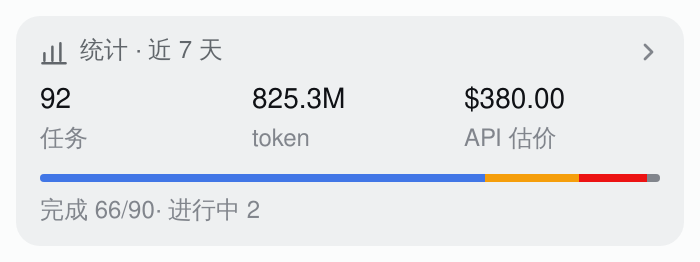
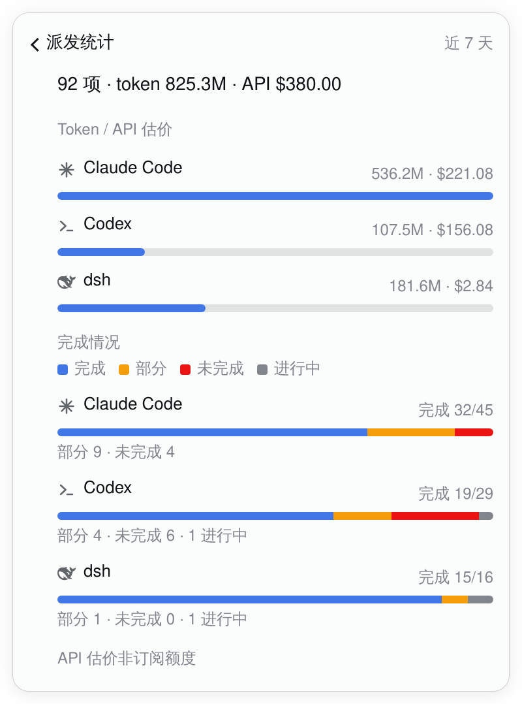
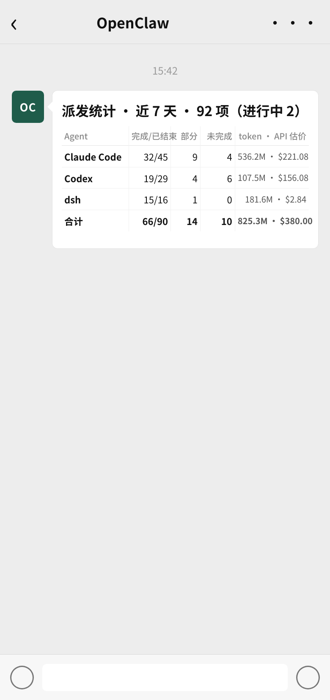

# Dispatch stats: a card and a chart layer, plus `/dispatch-stats` (2026-10-18)

The queue answers "what is running now". This adds the next question: "what has the
dispatch done over a window, and what did it cost?" It is a read-only projection of
`task_queue_ops.py summary`; no new measurement is taken, and no session is reread.

## The chip: a card, not a fourth fold

The bottom of the panel already has the patrol folds (earlier rounds, coverage). Stats is
therefore a **card between "just ended" and patrol**, not another `<details>`:



- **Collapsed**: one tile with the three readings and a completion bar. The bar is split
  into done / partial / unfinished / live; the numbers and the caption say the same thing,
  so colour is never the only channel.
- **Expanded**: tapping the card opens a chart layer with the same back bar as a task
  detail. It has per-agent token bars (scaled to the largest) and per-agent completion
  bars, plus one caveat line.



The full panel, with the card in place between recent tasks and patrol:
[full panel capture](dispatch-stats-panel.png).

### Lazy

The card is the only consumer of the new `taskStats(days, since, patrol)` Remote method.
The queue's 15s poll no longer runs `summary`; the read fires once when the panel opens
(or when the panel's refresh is pressed) and a late answer after closing is dropped. The
detail layer's request counter is the same shape. On a host whose half predates the
method, the card is absent and the queue is unaffected.

This removes the previous 127ms-per-poll cost (1,121 task directories) from the common
path. The card's values are therefore a snapshot; the manual refresh is how a reader asks
for a newer one.

## `/dispatch-stats`

The command prints one five-column table. The title carries the total and live count;
there is no trailing description:

```
# 派发统计 · 近 7 天 · 92 项（进行中 2）

| Agent | 完成/已结束 | 部分 | 未完成 | token · API 估价 |
|---|---|---|---|---|
| Claude Code | 32/45 | 9 | 4 | 536.2M · $221.08 |
| Codex | 19/29 | 4 | 6 | 107.5M · $156.08 |
| dsh | 15/16 | 1 | 0 | 181.6M · $2.84 |
| 合计 | 66/90 | 14 | 10 | 825.3M · $380.00 |
```

- The five columns fit a 390px bubble at 11px with short cells; `完成/已结束` keeps the
  denominator next to the number, which a separate `已结束` column made too wide. The
  `token · API 估价` cell is the only long one and stays on one line at 10px in the capture.
- `plain` is the fallback: no table, one token-share bar per agent, and no trailing line.
  It exists because the table is a channel capability, not a guarantee.
- The earlier version's one-line tail (frozen/live/token-unknown/unpriced/patrol/API) is
  gone after kcn's review. The distinction survives where it belongs: the column header
  says `API 估价`; a cell with no price reads `—`; the chip's chart layer keeps one short
  `API 估价非订阅额度` line. The CLI `summary` still reports `tokens_unknown` and
  `cost_unpriced` for anyone who needs the counts.
- `7d`/`30d`, `all`, `YYYY-MM-DD`, `patrol` are one argument each; anything else returns
  the usage line and never reaches the ops entry.

### Does WeChat render the table?

The brief's `markdown="1"` divs are **kramdown/Pages**, not the WeChat card: the Pages
brief is rendered by the site, while `brief_card.py` (the WeChat message) is plain text.
The relevant WeChat evidence is the channel's `StreamingMarkdownFilter` in
`openclaw-weixin`: it lists tables (`|…|`) among the constructs it passes through, and the
filter applied to this exact table leaves every row intact. The account's `text_item`
message is still text, so the table's visual rendering is the client's; the capture below
uses the 390px bubble and five columns, and is labelled as a mock rather than a real
WeChat screenshot.



If a client shows the pipes instead, `/dispatch-stats plain` is the designed fallback; it
is also what a narrow screen gets without adding a trailing paragraph.

## What the numbers are (and are not)

`task_queue_ops.py summary` reads only the numbers each task froze into its `result.env`
when it ended (`TOKENS_TOTAL`, `COST_USD`). It never rereads a session: a later task
continuing the same session would be counted twice.

- **Live tasks** are counted in the task total and shown as `进行中`; they stay out of the
  token and cost totals.
- **Tokens unknown** is an empty record, not 0. A cell whose whole token value is unknown
  reads `—`; the CLI summary still reports the count.
- **Cost unpriced** is a model with no price row; the cell is `—`, not $0.
- **`free`** is counted apart (the opencode free pool).
- **COST_USD is an API list-price estimate**, not subscription quota spent. Claude and
  Codex run on subscriptions here; the 5h/weekly windows are account-wide and shared with
  interactive use, so there is no honest per-task quota attribution.
- **Patrol is excluded by default**; the window reads `全部（含巡检）` when it is included.

The table's `完成/已结束` and `未完成` are the model's `DONE`/`PARTIAL` outcomes and the
remainder respectively. The remainder is not silently dropped: the table's rows add up to
`已结束`, and the footnote gives the unknown/unpriced counts.

## Design notes

Three installed design skills informed the surface:

- **apple-design** — one material at a time (the card is the panel's existing well, not a
  second translucent layer); hierarchy from weight and spacing rather than more colour;
  focus returns to the opener; the layer is a sibling surface, not a modal; `:active`
  press feedback and `prefers-reduced-motion` are inherited from the panel tokens.
- **emil-design-eng** — no animation on data the reader is reading; the charts are static.
  The only motion is the existing press transform, on the exact properties, behind
  `prefers-reduced-motion`; hover is gated to `(hover: hover) and (pointer: fine)`.
- **animate** — the gate rejected chart entrance animations: a stats tile is an occasional
  read, not a first-time celebration, and moving bars would make numbers harder to compare.
  No new keyframes; no spring library; the layer swaps immediately like the task detail.

The bar colours reuse the panel's roles: blue for done, amber for partial, red for
unfinished, grey for live. Every segment has a text label or count beside it, so the
chart survives a greyscale screen.

## Captures

- **Card and layer**: real WebKit captures of this branch's `lib/client.js` on the live
  dsh, with the profile's locale rewritten to `zh` for the picture. The live host half
  predates `taskStats`, so the lazy RPC response and the host's `statsApi` capability flag
  were answered from the real `task_queue_ops.py --json summary --since 2026-10-12` snapshot
  at 2026-10-18 14:53 HKT;
  the UI, the lazy call and the charts are the shipped code. The card and layer are from
  the same snapshot.
- **WeChat**: the text is the real `src/text.ts` output for that snapshot; the bubble,
  table frame and avatar are a mock. The Markdown table is drawn as a client would render
  it, not as a literal screenshot of WeChat.
- The full-panel capture includes the host's live queue and balances, the same material
  the plugin README already publishes.
