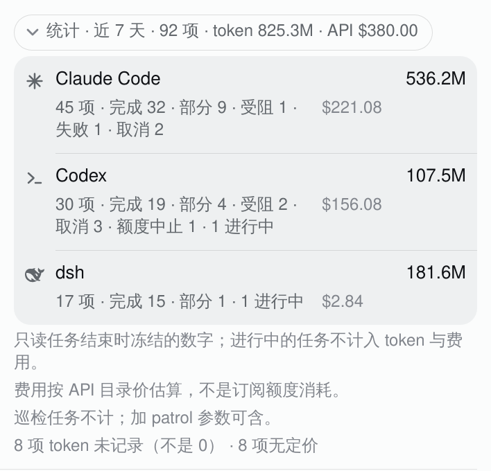

# Dispatch stats: the chip's stats fold and `/dispatch-stats` (2026-10-18)

The task chip answers "what is running now, and what is it waiting for". This adds
the next question: "what has the dispatch done over a window, and what did it cost?"
It is a read-only projection of `task_queue_ops.py summary`, the number set the CLI
already owns; no new measurement is taken, and no session is reread.

## The two surfaces

**`/dispatch-stats`** (OpenClaw, WeChat / Telegram) prints the summary as one
message. It defaults to the last seven local calendar days with patrol rounds
excluded. Arguments:

```
/dispatch-stats                  # last 7 days, patrol excluded (the chip's window)
/dispatch-stats 30d              # a rolling window, 1d..365d
/dispatch-stats all              # every retained task
/dispatch-stats 2026-10-01       # since a date
/dispatch-stats 30d patrol       # include patrol rounds
```

Anything else is answered with the usage line and never reaches the ops entry.

**The chip's stats fold** sits at the bottom of the provider panel, after the
queue, recent tasks and patrol. Its collapsed label is the whole headline (task
count, token total, API-price estimate); opening it shows one row per agent, then
the caveats. It keeps the chip's seven-day window; the command is where a wider
window is asked for.



The whole panel, for context (the fold is the last section):
[full panel capture](dispatch-stats-panel.png).

## What the numbers are, and what they are not

`task_queue_ops.py summary` reads only the numbers each task froze into its
`result.env` when it ended (`TOKENS_TOTAL`, `COST_USD`). It never rereads a session:
a later task continuing the same session would be counted twice. Both surfaces
carry the consequences in words, not in a footnote nobody opens:

- **Live tasks** are counted as tasks and shown as `1 进行中`, but stay out of the
  token and cost totals; those figures are still moving.
- **Tokens unknown** (`tokens_unknown`) is a task whose record was empty. It is
  not 0, and the line says how many tasks are in that state.
- **Cost unpriced** (`cost_unpriced`) is a model with no price row. It is not $0;
  the row shows `—` and the note counts them.
- **`free`** is counted apart (the opencode free pool).
- **COST_USD is an API list-price estimate**, not subscription quota spent. Claude
  and Codex run on subscriptions here; the 5h/weekly windows are account-wide and
  shared with interactive use, so there is no honest per-task quota attribution.
  The note under the rows says this in the same words as the panel's detail layer.
- **Patrol rounds are excluded by default**; `patrol` (or `--all` on the CLI) adds
  them.

The rows keep the two axes the summary reports: `COMPLETE`/`PARTIAL` come from the
model's `OUTCOME`, while blocked/failed/cancelled/quota come from the runner's
`STATE`. The `blocked` bucket takes whichever axis recorded it, and any remainder
prints as `其他`, so the parts never silently disagree with the task count.

## Why these shapes

- **A separate command, not a second screen of `/dispatch-list`.** The queue reply
  is already long (allowances, live tasks, recent, patrol). Stats is a different
  question and a different window; a sibling command keeps both answers short and
  lets a wider window be asked for without changing the chip.
- **A fold in the chip, closed by default.** The panel's primary job is live work;
  an always-open table would push patrol and the queue further down. The label is
  the answer, so a reader who never opens it still learns the totals.
- **Seven days by default.** It is a current operating window rather than a
  cumulative number that only grows; `all` and a date are one argument away.
- **One row per agent, token total as the value, cost in the aside.** The chip
  already aligns every row on one grid; the stats row reuses it instead of adding
  a second table style. The breakdown is the line under the name, the cost is the
  right-hand fact, and no row carries a state chip (totals are not a state).

## Captures

- **Chip**: a real WebKit capture of this branch's `lib/client.js` on the live dsh,
  with the profile's locale rewritten to `zh` for the picture. The live host half
  is not installed during the capture, so the seven-day stats object was injected
  into the `clawockStudio/taskQueue` response; the numbers themselves are the real
  output of `task_queue_ops.py --json summary --since 2026-10-12` at
  2026-10-18 14:53 HKT. `since` is the seven-day window ending that day.
- **WeChat**: the text in the bubble is the real `src/text.ts` output for the same
  seven days; the bubble/phone frame is a mock, and the Markdown markers are shown
  as a chat client renders them. The literal output is quoted in the PR body.
- The full-panel capture includes the host's live queue and balances, the same
  material the plugin README already publishes.
