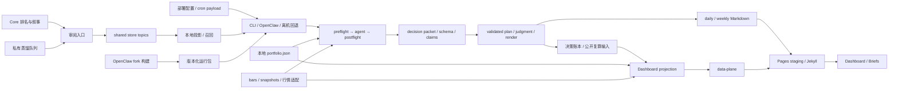

# 阶段 1 架构、状态与依赖审计

发布、记忆、散文及 OpenClaw 维护包以 `cf5c75ce2` 和现役维护包 `1e9c044b` 为基线。Python 包依赖以 [依赖清单](../../tests/package_edges.txt) 和 [AST 契约](../../tests/test_import_layering.py) 为准。下图补充源码 import 之外的进程、文件和 Git 边界，便于检查迁移影响。

## 架构与状态所有权

| 范围 | 权威实现或状态 | 实际读取方与改动边界 |
|---|---|---|
| 运行入口与调度 | `cli.py`、`scheduling.py`、`config/cron-schedules.json` 和共享 payload | OpenClaw cron、离机 fallback、调度同步。交互和 cron 是不同上下文。 |
| 投资输入 | `portfolio.json`、`market_data`、bars/snapshots、确定性决策账本 | preflight、postflight、Dashboard、复算和回放。保留本地路径、窗口、余额、时效及缺失口径。 |
| 任务与校验 | `context/brief.py`、`decision/packet.py`、`harness/brief_postflight.py`、`brief_contract.py`、`prose_claims.py` | model 只提交判断和计划。程序完成事实绑定、验证、渲染、入账和投递。 |
| 公开数据 | `publish/dashboard.py`、`scorecard_provenance.py`、data-plane 输出契约、`ops/pages/stage_site.py` | 组合/风险 JSON 与历史简报拥有不同生产者。Pages 从同一个 data-plane 提交读齐内容，再渲染现有 URL。 |
| 记忆 | shared store 的 topic、`memory.py` / `memctl`、`publish.py` | Core 排名候选、直接对话/任务蒸馏、叙事三个来源。MEMORY/DREAMS 是本地投影，交易 topic 与 cron 注入保持原样。 |
| 包与主机 | fork CI 的 tarball 与 build-info、`manage_openclaw_patches.py`、主机插件安装器 | 已选安装目录、网关、CLI 与 provider 插件。只有 fork 构建拥有适配字节，主机升级只负责校验和既有插件生命周期。 |
| DSH 与产品界面 | `examples/dsh/packages/clawock-dsh`、dispatch runner、`site/assets/js/dashboard.*` | npm 发布、交互与定时队列、页面消费公开数据。保留源码、安装入口和 CI。 |

## 重复实现与契约偏离

| 观察到的重复或偏离 | 收敛与旧路径退场 | 机器防回归 |
|---|---|---|
| 简报规则在大 SKILL、cron payload 与单轮 fallback 各自进入上下文。部分测试绑旧文件。 | 入口管动作，单层 reference 管各阶段规则。fallback 展开同一文件，测试改到真正的规则所有者，删除旧位置的副本。 | 引用覆盖、真实失败样本、context audit/verify/compare、现有 schema+渲染测试。 |
| Core promotion、`review_dreaming`、`review_dreams`、`intake.py` 拥有不同收据与候选筛查。 | Core 只产候选。统一 L1/L2/L3 与 public/private/archive 路由后停掉旧活跃写入；旧收据按兼容规则只读。 | 敏感拒审、数字绑定、来源去重与 exact-hash、过期/反证、故障保持最后可用投影。 |
| 私有投影还进入 master，且根 allowlist 与 context audit 曾把缺失视为损坏。 | 先迁移运行时读者，再移出跟踪并封住发布写入。原样保留注入文件，公开贡献规则单独拥有。 | 新 clone 缺本地投影兼容、live 重建校验、检查 allowlist 双向一致、提交/CI 路径闸。 |
| Pages 依赖 master 简报，data-plane 只携带数值产物。全树覆盖写入不能和归档独立 writer 并存。 | 归档先种入同一 data-plane，统一快进更新、固定 ref 与 hash 校验。持续写入接通以后移除 master 旧发布路径。 | 完整目录索引、损坏与缺文件拒收、并发 writer 保留、163 篇归档与 5 篇正文对拍。 |
| 管理器和 fork 移植都可改产物，同一种适配有两个生效点。 | fork 包生成适配及回执，主机校验安装目录与哈希。旧就地写入从运行入口退出，恢复既有历史包的工具保持显式。 | fork 构建和安装检查、改包拒绝、插件/记忆/cron 冒烟、前后 Dashboard 对拍。 |
| plan、judgment 和事实字段同时出现在 prose 说明、示例和验证代码。 | 保留业务校验，结构合法性归 schema。生成参考文档；证据 locator 和可解析字段同时进入发布校验。 | 生成物防漂移、schema 错误 fail、结构合法后的业务告警按现行阻断契约逐项确认。 |

删除一层前追踪其真实调用方。保留 Git 发布适配层，因为它封装 ref 固定、原子物化与重试。取消自行发信的脚本转发之前，核对 watchdog 与回执约束。查到的旧 reader 兼容留有明确用途与退出条件。

## 后续轮次

UI/设计系统及 DSH 布局由现有组件契约独立治理。腾讯 日线、报价与不同风险窗口的重复入口先对拍失败值与复权逻辑。跨域的领域模型、缓存、权限、认证、日志、测试工具链及 import 账本按 [架构入口](../architecture/harness.md#capabilities-one-owner-any-entry) 排后续轮次。本任务保持投资计算、UI 排版与发布 URL，先迁调用方、验证替代路径，再退役旧写入。消费契约或失败语义不同的实现继续各自拥有。
