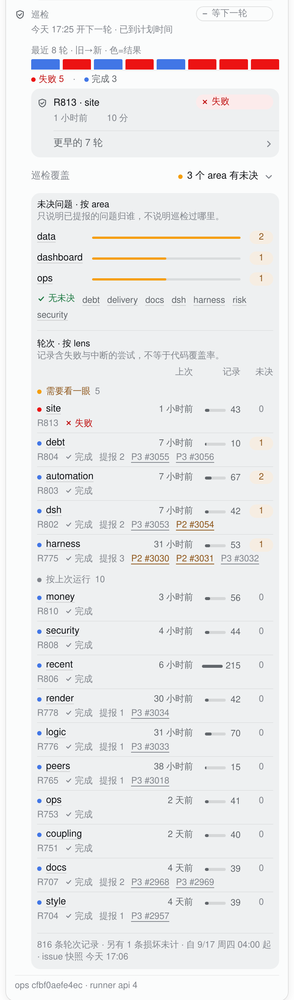

# The task chip's patrol block: a rhythm chart, a lens ledger, and two folds (2026-10-18)

The patrol section of the dsh task chip keeps the 2026-10-04 rule — **the fold's label is the
headline** — and the first pass changed the two folds from capsules to rows: the earlier rounds
continued the rounds well, the coverage summary became a key/value row. That fixed the shape. It
did not fix the reading: the coverage archive was still 15 rows of four plain numbers under one
last-run sort, the only colour was the last-round failure chip, and the pattern of failed rounds
was invisible until every row was read. The section looked like a table next to a dashboard.

This pass keeps the folds and the columns and adds the missing encoding: one small outcome chart
for the rounds, a grouped lens ledger with a status dot, a runs bar and an open badge, amber area
bars with count badges, and a colour mark on the coverage summary. The numbers are unchanged; the
new marks are the same values in a second channel.

## The rhythm

The last rounds are already a list; the rhythm is the same data as a shape above it:

- one equal-height tile per round, oldest on the left, newest on the right; the count line under
  it says the dates in words (`失败 5 · 完成 3`);
- the tile colour is the round's verdict on the **stats card's chart scale**: done `--tq-run`
  (business blue), partial or preempted `--tq-wait` (warn amber), failed `--tq-bad` (error red),
  no verdict `--tq-idle` (grey). The chip inside a row keeps its own role; the chart is a summary
  and uses the chart scale, exactly as the stats card's completion bar does;
- every tile carries its round, axis, verdict and recorded duration in its title. A round with no
  recorded duration is still a tile; the duration is never inferred.

**Why the tile is not a duration bar.** The first attempt encoded duration as bar height. One
44-minute round flattened the 2–10 minute rounds into a 3px line: the chart showed an outlier, not
the patrol rhythm. A log scale would have made the small rounds readable but misstates the
magnitude in a glance chart. The duration belongs in the row and the tile's title; the chart keeps
the one thing a reader scans for — the run of failures. This is the same choice as the stats card:
the completion bar encodes outcomes, not time.

## The lens ledger

The lens table had two jobs in one last-run sort: show the rotation gap and surface the few lenses
that need attention. It now has two bands:

- **needs a look** — a lens with an open issue or a failed last run. The band heading is amber and
  carries the count; inside, the rows stay in last-run order, so the most recent failure is first.
- **by last run** — the rest, most recently run first, so the rotation gap still reads down the
  `when` column (the 2026-10-04 criterion). The heading is quiet and carries the count.

Each row carries three marks, all with their word or number beside them:

- a **status dot** in the last-run verdict's chart colour (done blue, partial amber, failed red,
  no verdict grey) before the lens name;
- a **runs bar** against the busiest lens, with the recorded count at its right. Runs are activity,
  not a verdict, so the bar is neutral ink, not a semantic colour;
- an **open badge**: amber when the count is positive, quiet grey at zero, dashed when the issue
  source is unknown. The number is inside the badge; colour is never the only carrier.

The columns are unchanged (`上次 / 记录 / 未决`) and the numbers stay on their right-aligned tracks:
the 2026-10-04 rule that a count sits under a count is still true. We added marks to the cells, not
a new column order.

The **areas** table already listed open areas first; its bar is now `--tq-wait` (amber: something
to look at), each count is the same badge, and the none-open line gets a green check and a green
label. The **coverage summary** gets a 6px dot before the conclusion: green for none open, amber
for open, warn for unknown. The words still say it.

## Motion

| What | Why | Normal | Reduced motion |
|---|---|---|---|
| Fold content (both folds) | no jump: a large block would otherwise appear all at once | opacity 0→1, 240ms, strong ease-out; layout is immediate | appears |
| The rhythm tiles | explanation: the chart draws its sequence once, left to right | scaleY 0→1 from the baseline, 240ms, 30ms apart | final tiles |
| The coverage bars (area and runs) | explanation: a bar grows from its zero end, so length is read as a measure | scaleX 0→1 from the left, 240ms, 30ms apart, capped at 8 steps | final bars |
| A rhythm tile under the pointer | feedback: which round is this? | 150ms box-shadow, fine pointers only | the same, no motion |
| The fold chevron | state | 150ms rotation (existing) | instant |

- **No loop, no count-up, no tweened value.** The tile and bar lengths are the real values at every
  frame; the entrance is an uncovering from the zero end, which the design system allows. A figure
  is never rolled. The 15s refresh does not replay the entrance: the marks stay put and the real
  numbers repaint.
- **Frequency.** The rhythm is part of opening the panel (tens of times a day, so a single 240ms
  reveal); the coverage bars play when the reader opens the archive (occasional). Nothing animates
  on hover except a colour/shadow, and nothing animates on the poll.
- **Why the fold body and its bars use a one-shot keyframe.** In WebKit 26.4, `@starting-style`
  does animate an always-rendered element (the rhythm tiles use it), but it did **not** fire for a
  `
` body entering from `display:none`; the body stayed at opacity 1. The fold therefore
  uses a `[open]` keyframe for the body and its bars. Closing is instant, so there is no exit to
  interrupt; reopening replays the one-shot. A transition would be preferable for a rapidly
  toggled control, but the native details DOM does not give it a start value here.
- **Under `prefers-reduced-motion`** the body and the bars have no animation and the tiles have no
  transition; their final state is the first frame. The chevron and the pill's press are also
  instant. Colour remains, because it is the data.

## What was considered and left out

- **Duration as bar height.** Rejected above: the outlier flattened the rest; a log scale would
  misstate magnitude.
- **One stacked outcome bar instead of a sequence.** Rejected: it shows the mix but loses the run
  of failures, which is the thing the list cannot show at a glance.
- **A per-lens history sparkline.** The coverage payload carries one last round per lens and the
  eight rounds of the history, not a per-lens series; drawing one would need a new host field. The
  runs bar gives the activity without inventing a history.
- **Sorting every lens by open count.** Rejected: it destroys the rotation gap, which is a real
  audit. The exception band gives the open/failed rows the top without reordering the rotation.
- **Animating the count up or pulsing an open badge.** Rejected: a reading never loops, and a
  number that counts up shows values that were never true.
- **A third card or a layer for coverage.** Rejected in the first pass: the stats card is the one
  card in the block; coverage is an archive, not a detail layer.
- **Merging the two folds.** Rejected: it buries the conclusion behind a generic label and makes
  one control answer two questions.

## Skill notes

| Skill | Principle used | Where it lands |
|---|---|---|
| apple-design | hierarchy from weight + size + leading as a set, not colour alone; one material at a time; reduced motion keeps colour/opacity and drops movement | the key/value summary (13/regular key, 13/strong conclusion), the chart marks on the existing panel/well, no new card; the fold fade and the static reduced-motion bars |
| emil-design-eng | match motion to frequency; UI under 300ms; strong custom ease-out; 30–80ms stagger; never animate a figure the reader is reading | 240ms one-shot reveals, 30ms stagger (capped at 8), `cubic-bezier(.23, 1, .32, 1)`, no animation on the 15s poll; the values are static and only the zero-end reveal moves |
| animate | run the gate first: frequency, purpose, cheapest tool, transform/opacity only; reduced motion and pointer gating ship with it | the table above: no loop, CSS only, scaleY/scaleX/opacity, `prefers-reduced-motion` and `(hover: hover) and (pointer: fine)` |
| animation-vocabulary | name the effects so the implementation and the PR describe the same thing | *stagger* for the tiles and bars, *reveal* for the zero-end growth, *fade* for the fold content; no *pulse*, *loop* or *number ticker* |
| improve-animations | recon → audit → missed opportunities; do not re-litigate settled motion; extend tokens | the audit found the panel had only press/hover/chevron; the missed opportunity was the chart entrance and the fold's no-jump fade; the values extend the repo's 240ms/ease-out standard, not a new scale |
| review-animations | justified, frequency-appropriate, sub-300ms, transform/opacity, reduced motion, interruptibility | the table above and the WebKit `@starting-style` finding; the one deliberate exception (the details body keyframe) is stated rather than hidden |

`animation-vocabulary` is a glossary, not a design method; it named the effects, it did not justify
them. `improve-animations` and `review-animations` are read-only/audit skills by design; here their
methods were used to pick and check the motion, and the implementation follows in the same task.

## Captures

- **Real:** the closed, open and full-panel pictures are WebKit renders of this branch's
  `lib/client.js`, served in place of the installed bundle on the live dsh (light theme, 1280px
  viewport, device scale 2). The queue and stats RPC answers were frozen from the live host on
  2026-10-18 at 17:06 and 17:04 HKT; the host half, the rounds, the issues and the chrome are real.
  The live snapshot has nothing open, so the real pictures show the green/blue/red state.
- **Schematic:** `task-chip-folds-open-issues.png` uses the same live capture with only the open
  counts changed (data 2, dashboard 1, ops 1; automation 2, debt/dsh/harness 1) to show the amber
  state. Everything else, including the components, is the shipped code; the label says so.
- **Before:** the #3060 installed client, captured on the same host; the first-pass row version is
  in the PR's three-stage comparison (old commit).
