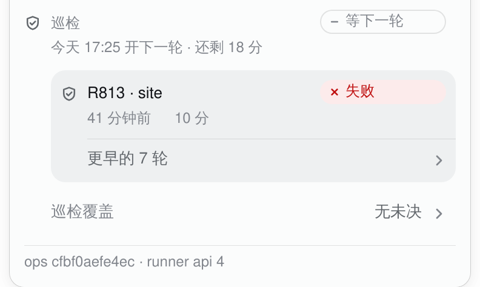
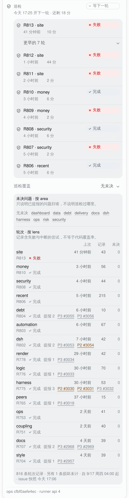

# The task chip's folds: a history row, a coverage summary, and the raw-log pill (2026-10-18)

The patrol section of the dsh task chip ends with two disclosures: the rounds older than the
resident one, and the read-only coverage archive. They answer different questions — *what came
before the round I can see?* and *did patrol leave anything open?* — but they used to wear the
same 26px hairline capsule, one just under the other, each only as wide as its words. The first
continued a list; the second closed a section with an answer. The shared shape made both read as
stray buttons, and the coverage answer read as a tag.

The section still has two disclosures. They are now two rows of one archive, and the coverage
answer is the strongest text in its row.

## What the section is saying

The 2026-10-04 coverage redesign left its rule in `panel.ts` (`CoverageView`): **the fold's label is
the headline** — a reader who never opens it still learns whether anything is open; inside, every
number has a column and is said once. The stats card from #3060 added a second rule: one surface,
one material; the card is a card, and the patrol archive is not a fourth card.

The disclosures stay two because merging them would bury the coverage conclusion behind a generic
“archive” label and make one control answer two questions. Moving coverage above the rounds would
suggest that the visible round's coverage is known; rounds carry no area, so the data cannot
support that (the 2026-10-04 ordering test already pins coverage after the rounds).

## The shape

- **Earlier rounds is a row of the rounds well, not a second control.** Its label starts on the
  round name's column (the same 8px row padding + 14px lead + 8px gap as a row), the chevron
  trails at the row's right edge, and the hairline above it starts on the name column. Opening it
  appends the older rows to the same well; there is no second surface under a floating pill. The
  row is 36px (44px under a finger) at 13/20 in secondary ink.
- **Coverage is the section's closing key/value row.** `巡检覆盖` is the quiet key, the conclusion
  is the strong value on the right — `无未决`, or `2 个 area 有未决`, or `未决数未知` in the warn
  role — and the chevron comes last. It is not a capsule: the row is the label for the coverage
  well below it. The accessible name is `巡检覆盖 · <conclusion>`, so the answer is heard whether
  the fold is open or not.
- **The raw supervisor log keeps the pill.** It lives inside a task's detail, not in the panel's
  archive; one fold still looks like a button there, and that is the right shape for it.
- **No new surface and no new material.** The stats card is still the only card in the block; the
  history row lives on the existing well, the coverage tables keep their existing well, and the
  summary row is a row on the panel. Nothing moved across the “recent tasks” / “patrol” boundary,
  and #3060's card and its spacing are untouched.

The whole panel, with the stats card above and the ops footer below:
[full panel](task-chip-folds-panel.png).

## Motion, touch, focus

No new animation. Opening is immediate (native `
`), as before. A row presses with the
panel's wash, not the pill's scale: a full-width row that shrinks would move the list under the
finger, while the raw-log pill keeps the 0.97 press. The chevron turns 90° on the existing
`--tq-fast` / `--tq-ease`, and `prefers-reduced-motion` removes that transition. Hover is behind
`(hover: hover) and (pointer: fine)`. Both rows are 36px; under `(pointer: coarse)` they grow to
44px themselves, so the hit area never borrows 9px from the row above or below (the pill keeps its
invisible `::after` target). Focus keeps the panel's `--tq-focus-ring`; the rows use an inset ring
so the well's `overflow: hidden` cannot clip it.

## What was considered and left out

- **One “archive” fold containing both.** Rejected: it buries the coverage conclusion and mixes two
  questions.
- **Coverage as a third card or a detail layer.** Rejected: the stats card already owns the card
  shape, and the coverage tables are an archive, not a task detail.
- **Coverage permanently open.** Rejected: the two tables are 800px+ tall, and the closed summary
  row already carries the conclusion.
- **Coverage above the rounds.** Rejected: the data cannot support per-round coverage, and the
  2026-10-04 ordering test pins it after the rounds.
- **Changing the stats card or its spacing.** Left as #3060 shipped it; it answers a different
  question and remains the block's only card.

No host method, RPC field or stored number changed: this is the client's projection only. The
`CoverageView` model gained `conclusion` and `tone` (the two halves of the summary) instead of one
pre-joined `headline`; the coverage payload itself is unchanged.

## Captures

The three pictures are real WebKit renders of this branch's `lib/client.js`, served in place of the
installed bundle on the live dsh (light theme, 1280px viewport, device scale 2). The queue and stats
RPC answers were frozen from the live host on 2026-10-18 at 17:06 and 17:04 HKT; the host half, the
data, the chrome and the footer are real. The locale is rewritten to `zh` for the picture (the live
profile's preference is English), the same choice #3060 documented. Nothing here is drawn or
mocked: the wells, the rows and the tables are the shipped DOM and CSS.
