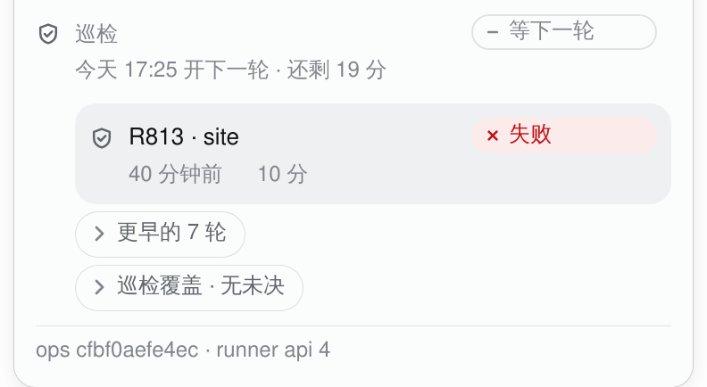
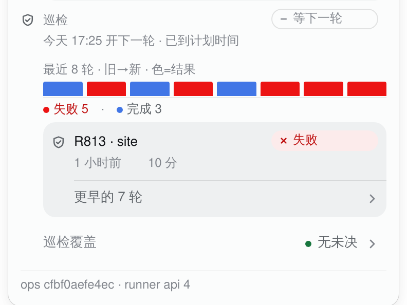
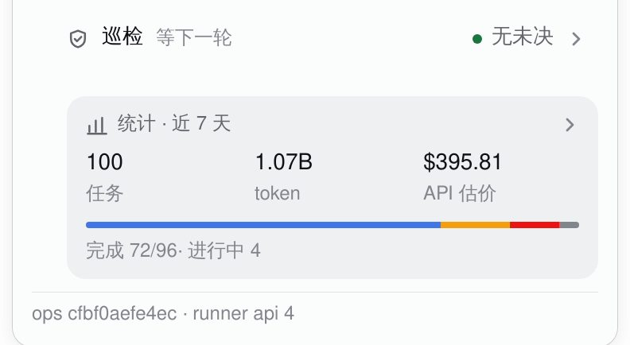
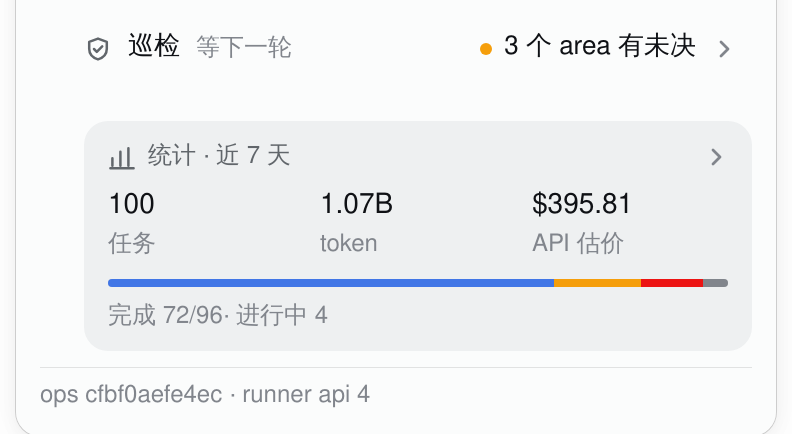
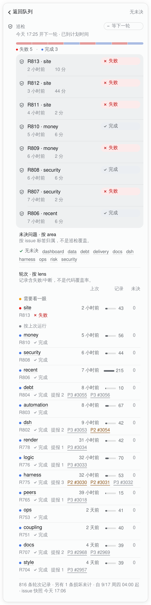
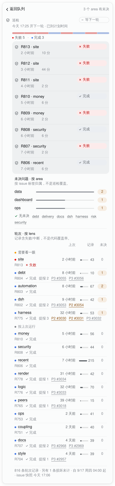

# The task chip's patrol block: one entry, one page (2026-10-18)

The previous pass made the patrol history one list and moved coverage to a page, but the panel
still had three parts: the patrol head, the round list, and the coverage link. kcn's fifth review
named the redundancy: **merge patrol and patrol coverage into one entry; the rounds and the
coverage tables both live in the page**. This pass does that, and the panel's patrol section is now
a single row.

| #3060 before | v2 (8846441) | v4 (this pass) |
|---|---|---|
|  |  |  |

The v3 intermediate (one list + coverage link) is in the PR's final-design section at commit
`5420ed0`; this file keeps the final and the two far ends.

## The entry

One row, 44px, the only patrol control in the panel:

- the shield, the label **巡检**, the live phase (`等下一轮`), then the coverage conclusion on the
  right (`无未决` green / `N 个 area 有未决` amber / `未决数未知` warn), then the chevron;
- the accessible name carries all three: `巡检 · 等下一轮 · 无未决 · 打开巡检详情`;
- the 2026-10-04 case still holds: the conclusion is in the row, not hidden behind a neutral
  "coverage" label; the row's label is the subject, the value is the conclusion. Colour is only a
  6px dot; the words say it.

The open version is a schematic (the live 17:06 snapshot has nothing open): only the open counts
are changed, to show the amber conclusion. The rest is the shipped render.

## The page

The entry opens the existing detail layer — the same `.tq-layer`, back bar, focus return and Escape
as a task detail or the stats card; no new navigation. The page:

- the back bar says **返回队列** (the page's subject is the head row below it, so the back bar does
  not repeat "巡检"); the caption is the coverage conclusion;
- the live head row (phase chip + the next-round caption) is the page's first row;
- the 6px outcome strip and its counts, then every round the host sends (at most eight), newest
  first, in one well;
- the coverage tables in the same page: areas first (neutral magnitude bars, amber count badges,
  the green none-open line), then the lens ledger (two bands, status dot, neutral runs bar, open
  badge), the two short caveats and the provenance footer;
- closing the page returns focus to the entry. There is no second fold and no second coverage
  entry.

The open counts are the only schematic difference; the rounds, live head, strip, components and
WebKit render are real.

## What was removed

- the separate patrol section head in the panel;
- the panel's 6px strip and 8-row list (they moved to the page);
- the separate coverage link row (its tables moved into the same page);
- the duplicate coverage page;
- the previous "巡检覆盖" page title (the page is **巡检**, and its coverage tables are sections
  inside it).

Kept: the phase, the next-round caption, the verdict strip and counts, every round, the area/lens
tables, the two caveats, and the provenance. The panel's only patrol control is the entry.

## Colour and motion

The entry uses ink text and a 6px dot (green/amber/warn), no saturated fill. The page's strip is the
same 6px, 35% chart tint as v3; the area bars are neutral; the lens dots are 6px solid; the band
dot is amber. The stats card below the entry and its stacked provider chart are documented in
[`task-chip-stats.md`](task-chip-stats.md).

The strip draws once when the page mounts (240ms, 30ms stagger, `@starting-style` + transition).
The page itself swaps immediately: it is navigation, not an expansion. The raw supervisor log's
fold inside a task detail is the only `
` left; the patrol page has none. Reduced motion
shows the final strip. Hover is fine-pointer gated; the entry is 44px; focus ring and back focus
are shipped.

## Skills, this pass

| Skill | What it did | Where |
|---|---|---|
| apple-design | restraint: the best change was deleting two of three parts, not restyling them; one material (the entry on the panel, the page on the layer surface); optical sizing (6px strip, 5/6px dots, 12/13px labels) | the one entry, the one page, the stats at the bottom |
| emil-design-eng | invisible details: 44px entry, the phase truncation, the back label, the 1px segment gaps, the focus return, the strip once per page open, no chart animation | entry/page/strip/stats |
| animate | the gate: the page is navigation and gets no entrance; the strip gets one reveal because it explains a sequence; no loop, no value tween | the page swap and strip |
| animation-vocabulary | **not used**: no new effect to name; the strip is still a stagger/reveal and the raw log is a fade; forcing the glossary would add words, not design | — |
| improve-animations | the audit found the redundancy was structural, not motion; the only motion fix remains the reduced-motion coverage-bar override | the final reduced block |
| review-animations | the page is navigation (immediate); the strip is sub-300ms transform-only; the raw-log details keyframe is the one exception, because WebKit 26.4 does not fire `@starting-style` for a body entering from `display:none` | the motion table |

`animation-vocabulary` is a glossary and did not help this pass; `improve-animations` and
`review-animations` are read-only methods; `apple-design`/`emil-design-eng` did the subtraction.

## Alternatives

- **Keep the head + list + coverage link**, only restyle. Rejected: kcn named the redundancy; three
  parts were the problem.
- **One entry that expands in place** (a fold). Rejected: the detail layer already has the back bar,
  focus return and surface; a fold would recreate the disclosure pattern the previous rounds
  removed and would put the rounds and coverage back in the panel.
- **A real route for the page.** Rejected for the same reason as before: it is a larger app change,
  and the existing detail layer already solves back/focus/escape.
- **A second coverage entry inside the page.** Rejected: that is the redundancy again; the tables
  are sections of the one patrol page.
- **Keep the panel's strip as well as the entry.** Rejected: kcn asked for one row or a very light
  summary; the strip is in the page where the rounds are.

## Captures

- Real: `task-chip-patrol-summary.png` (the one row + the closing stats card), `task-chip-patrol-
  detail.png` (the page with the rounds and both tables), `task-chip-patrol-panel.png` (the full
  panel), and `task-chip-patrol-stats.png` in the stats note. WebKit renders of this branch's
  `lib/client.js` on the live dsh; queue/patrol frozen at 2026-10-18 17:06 HKT; the stats card is
  the later 18:30 lazy read from the live task dirs through the new ops source. The installed host
  half is still #3060; no install/restart was run.
- Schematic: `task-chip-patrol-summary-open.png` and `task-chip-patrol-detail-open.png` change only
  the open counts (data 2 / dashboard 1 / ops 1; automation 2 / debt·dsh·harness 1); everything else
  is the shipped render.
- Before/v2: #3060 and commit `8846441`; the v1 row pass is at `2aa2f929f`. The PR body's final-design
  section explains which image is which round.
