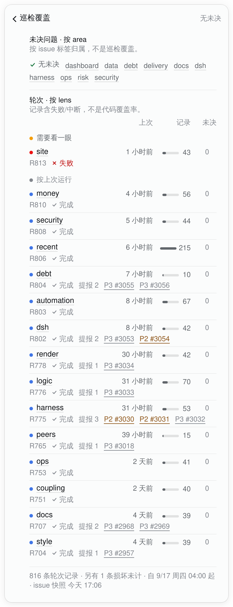
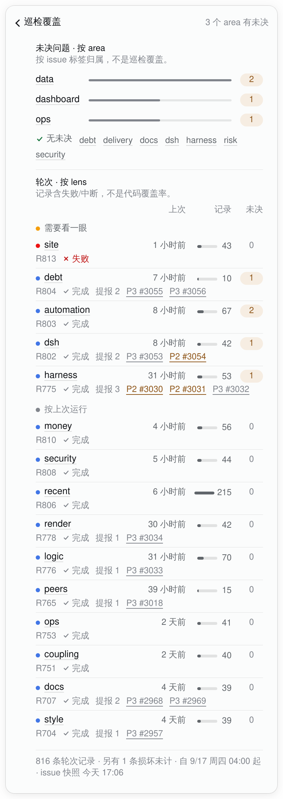

# The task chip's patrol block: one round list, one thin strip, one coverage page (2026-10-18)

The 2026-10-04 rule — **the fold's label is the headline** — was about one control. The patrol
block had grown two: the earlier rounds continued behind a fold, and the coverage archive sat
behind another disclosure right below it. Even after the first pass turned both into rows, two
adjacent clickable rows still read as a pair of controls. kcn's third review named the structure,
not the shape: merge the older rounds into the one list, make coverage a page, drop the extra
description, and tone the chart down.

This pass does that. The patrol section now has **no fold**: one list with every round the host
sends, a 6px outcome strip above it, and one coverage link at the end that opens the existing
detail layer. The colour rule is a tier scale, not a new palette: solid tokens only on marks of
6px or less, a 35% tint for the one outcome strip, neutral bars for magnitudes. The v2 caption,
the band counts, the amber area bars and the long panel notes are gone.

| #3060 before | v2 (commit `8846441`) | v3 |
|---|---|---|
|  |  |  |

## The structure

**One list.** The host sends at most eight rounds (`TaskQueueResult.patrol.rounds`). The panel
renders all of them in the same well, newest first. There is no "earlier N rounds" row, no second
well, and no control between the resident round and the older ones. If the host cap ever grows,
the fallback is a lazy-load row at the end of this one list — a button, not a fold. The list is
read-only; the only control in the section is the coverage link.

**One strip.** The summary is the same rounds as the list, in the same order, one segment per
round, 6px high. The strip takes the chart roles from the stats card (`done` blue, `partial` /
`preempted` amber, `failed` red, no verdict grey) at a 35% tint. Under it, the counts are the
legend in words; the red/blue words of v2 are now neutral text with 5px coloured dots. There is
no caption: the strip sits directly above the list and shares its newest-first order, so "最近 8
轮 · 旧→新 · 色=结果" was explaining what the adjacency already says. Each segment keeps its
round, lens, verdict and real duration in its title.

**One page.** The section ends with one link row: quiet title left, conclusion right, chevron
last. It opens the coverage page in the same `.tq-layer` / back bar / focus move as a task detail
and the stats card. It is not a browser route and not a fourth card; the page uses the panel's
own surface and returns with the back button or Escape. Because the page replaces the list, the
rounds and the archive never sit next to each other as two disclosures.

The page keeps the four-column lens ledger and the two bands. The band headings are now one word
and a dot, with no counts (the rows are the count). The area bars are **neutral ink**: the bar is
a magnitude, the amber count badge is the state. The status dot, the neutral runs bar and the open
badge keep their meanings; the last-round line still says the verdict and the filings in words.
The area caveat and the lens caveat are one short line each; the provenance stays as the footer.
The page only exists while it is open; there is no extra RPC, because the coverage data is
already in the queue payload.

## Why v2 read as “too loud”

The v2 strip was eight **14px** tiles at full chroma. At a 324px content width each tile was about
36px wide, so the strip painted **8 × 36 × 14 = 4,032 px²** of `--tq-run` (#4176e6) and
`--tq-bad` (#ec1313) at 100% saturation — the largest solid colour area in the panel, about 5% of
the closed section and 3.5× taller than the stats card's 4px completion bar. The panel is mostly
grey; the eye reads that block first, before the rows or the conclusion.

The rest of the colour was small but simultaneous: 15 solid 6px lens dots, an amber band label,
solid amber area bars when open, a green “none open” label, and the red/blue count words. The hue
count was not the problem — four chart roles + healthy green + neutral is the stats card's own
set. The problem was **area at full chroma**, plus several accents competing in the same block.
Replacing the palette with paler hand-picked colours would have moved the same area to a different
hue; that is why this pass changes the *tier* and the *area*, not the tokens.

## The colour scale

One rule, defined once on the panel and reused by the strip and the page:

| Tier | What it is | Token | Where |
|---|---|---|---|
| **Mark** | a state, 6px or less | solid semantic token (`--tq-run`, `--tq-wait`, `--tq-bad`, `--tq-idle`, `--tq-text-ok`) | 5px strip legend dots, 6px lens/link dots, 11px green check |
| **Outcome bar** | a sequence of verdicts | `--tq-chart-*` = `color-mix(in srgb, semantic 35%, transparent)` | the 6px strip |
| **Magnitude bar** | a count relative to the largest | neutral `--tq-ink-3` / `--tq-ink-2` | area bars, lens runs bars |
| **Wash** | a row/badge bed | the existing 10% chip fills / soft tokens | open badges, failure chips |
| **Text** | the word | `--tq-text-*`, `--tq-ink-*` (contrast-adjusted) | every state word |

The strip's painted area drops from 4,032 to **1,944 px²**, and its saturation from 100% to 35%;
the effective full-chroma area drops from 4,032 to about **680 px²**, an ~83% reduction. The area
bars go from solid amber to neutral, so the open state is carried by the small amber badge and
the band dot. The panel's largest solid mark is now the 6px dot; no solid fill is larger than a
mark. The strip still uses the same four semantic roles and the same stats-card scale; no new
hue, no hand-picked pastel, and the stats card is untouched.

## Motion

| What | Why | Normal | Reduced motion |
|---|---|---|---|
| The strip | explain the outcome sequence once | 8 segments, `scaleX` from the left, 240ms, 30ms apart | final segments |
| The coverage page's bars | explain the length from the zero end | `scaleX` from the left, 240ms, 30ms apart, capped at 8 steps | final bars |
| The raw-log fold (inside a task detail) | no jump for the one remaining fold | body opacity 0→1, 240ms | appears |
| The coverage page itself | navigation: a page swap, not an expansion | immediate, like a task/stats layer | immediate |
| Hover / focus | feedback | wash or ring, fine pointers only | same, no motion |

No loop, no count-up, no tweened value: the lengths are the real values at every frame, and the
15s poll does not replay an entrance. The strip runs once per panel open; the page bars once per
page mount. The raw-log fold is the only `
` left in the panel. Its body still uses a
one-shot `[open]` keyframe because WebKit 26.4 does not fire `@starting-style` for a body entering
from `display:none`; closing is instant, so there is no exit to interrupt. The strip and the page
bars are normally mounted elements and use `@starting-style` + a transition. The coverage rules
sit after the general reduced-motion block, so the bars get a second `transition:none` override
there; without it, the `@starting-style` zero stayed in reduced motion and the bars were invisible.

## What was removed, and what was kept

Removed from the panel:

- the second fold and its “更早的 7 轮” label;
- the v2 rhythm caption (“最近 8 轮 · 旧→新 · 色=结果”) and the red/blue count words;
- the band counts (“需要看一眼 2”, “按上次运行 1”);
- the long coverage notes from the panel (they now live, shorter, on the page);
- the solid amber area bars and the amber band label;
- the 14px solid tiles.

Kept, because they are the conclusion or the reading rule:

- every round, its verdict, time, duration and filing;
- the count line under the strip (`失败 5 · 完成 3`);
- `无未决` / `N 个 area 有未决` / `未决数未知` — unknown is not zero;
- the area caveat (“按 issue 标签归属，不是巡检覆盖”), shortened but not dropped;
- the lens caveat (“记录含失败/中断，不是代码覆盖率”);
- the provenance footer (records, broken line, issue snapshot);
- the API-estimate / subscription wording elsewhere in the panel, untouched.

## Skills, this pass

The six skills were read in the first pass. This pass used them for subtraction, not for another
coat of paint.

| Skill | What it gave this pass | Where it lands |
|---|---|---|
| apple-design | restraint: the best fix was to remove a control, not add a chart; optical sizing/tracking/leading as a set (the 12/13px labels, 5px dots, 6px strip); one material (no new card or well; the page is the layer's own surface); reduced motion keeps the colour and drops the movement | the one list, the page, the 6px strip, the 12/13px type, the static reduced state |
| emil-design-eng | the invisible details: 1px gaps between strip segments, a 6px height that reads as a line not a block, a 35% tint instead of a pastel, neutral magnitude bars, a full-width 36px link that grows to 44px on touch, the focus ring and the back focus move; frequency: once per open, never on the 15s poll | the strip, the link, the page, the reduced/hover rules |
| animate | the gate before the effect: the page needs no entrance (it is navigation), the strip and the bars earn one reveal each because they explain a length/sequence; transform only; the reduced/hover gates ship with the motion | the motion table; the page swap is immediate |
| animation-vocabulary | **not used this pass.** There was no new effect to name: the strip is a stagger/reveal, the fold fade is a fade, and naming them again would not change a pixel. The skill is a glossary, not a design method. | — |
| improve-animations | the audit found the real problem was not missing motion but the v2 colour area and the second fold; the one motion to fix was the reduced-motion coverage bar (it was stuck at scaleX(0) because the reduced rule preceded the coverage rule); fixed and re-tested | the final reduced block, the audit note |
| review-animations | check the ten standards; the page is navigation and stays immediate; the strip/page bars are sub-300ms, transform-only, one-shot; the raw-log fold's keyframe is the one deliberate exception, stated rather than hidden | the motion table and the caveat above |

`animation-vocabulary` is a glossary and did not help here; `improve-animations` and
`review-animations` are read-only by design, so their methods were used and the implementation
was done in this task. `apple-design` and `emil-design-eng` did the actual subtraction. The
coverage page follows the existing task/stats layer pattern rather than inventing a new
navigation surface.

## Alternatives

- **A lazy-load “more” row instead of all eight.** The host caps the list at eight, so there is
  nothing to load; all eight fit and the section is ~300px taller. If the cap grows, a lazy-load
  button at the end of this one list is the fallback — never a fold.
- **A real route for coverage.** A URL/route would need app chrome and would lose the panel
  context; the existing detail layer is the same pattern as a task and the stats card, with the
  back bar and focus return already solved. A route is a larger app change, not this PR.
- **A separate coverage card / fourth fold.** Rejected: it recreates the adjacent-control problem
  and adds a surface; the page is the detail layer.
- **A new, paler palette.** Rejected: the semantic tokens are fixed by the design system and the
  issue was area, not hue. The 35% tint is derived from the same token, not picked by eye.
- **No colour at all.** Rejected: the verdict sequence is data; the marks and the words both
  carry it, so a greyscale or screen-reader reading loses nothing.
- **A duration-height chart.** Already rejected in v2: one 44-minute outlier flattened the 2–10
  minute rounds; duration stays in the row and the segment title.

## Captures

- **Real:** `task-chip-patrol-summary.png`, `task-chip-patrol-coverage.png` and
  `task-chip-patrol-panel.png` are WebKit renders of this branch's `lib/client.js`, served in
  place of the installed bundle on the live dsh (light theme, 1280px viewport, device scale 2).
  The queue and stats answers were frozen from the live host on 2026-10-18 at 17:06 and 17:04
  HKT. The host half, the rounds, the issue counts and the chrome are real. The live snapshot has
  nothing open, so the real coverage page is the green/blue/red state.
- **Schematic:** `task-chip-patrol-coverage-open.png` uses the same live capture with only the
  open counts changed (data 2, dashboard 1, ops 1; automation 2, debt/dsh/harness 1), to show the
  amber state. Everything else, including the components, is the shipped code; the label says so.
- **Before / v2:** the #3060 installed client and the v2 commit `8846441`; the three-stage table
  at the top is the comparison. The first-pass row version is at commit `2aa2f929f`; it is not a
  separate design anymore.
