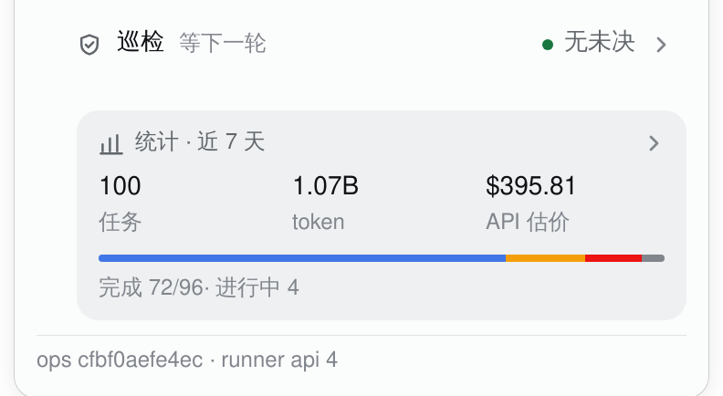

# The task chip's patrol block: one entry with a strip, one dashboard page (2026-10-18)

The fifth pass merged patrol and patrol coverage into one entry and one page. kcn accepted the page
("点进去详情没有问题了") but the panel looked too plain with only the one 44px row, and the page
read as a single long column. The sixth pass adds a **small, static outcome strip inside the entry**
and turns the page into a **dashboard**: four KPI tiles, then outcome / rounds / coverage cards.
The page's content and the one-entry structure stay.

| #3060 before | v2 (8846441) | v4 before (552c934) | v5 (this pass) |
|---|---|---|---|
|  |  |  |  |

The v3 intermediate (one list + coverage link) is in the PR's final-design section at commit
`5420ed0`; this file keeps the final and the near-before.

## The entry

One button, the only patrol control in the panel:

- line 1: the shield, **巡检**, the live phase (`等下一轮`), the coverage conclusion on the right
  (`无未决` green / `N 个 area 有未决` amber / `未决数未知` warn), then the chevron;
- line 2: a **4px strip** of the last eight round outcomes, newest first, one segment per round,
  the same 35% chart tints as the page's 6px strip;
- the strip is inside the button (`aria-hidden`, no separate click target, no counts); the whole
  row remains one 54px-tall hit area (≥44px), one focus ring, one click;
- the accessible name is `巡检 · {phase} · {conclusion} · 打开巡检详情`, so the outcome strip is
  decoration over words that are already in the name.

The live 17:06 snapshot has nothing open; the open version changes only the counts to show the
amber conclusion. The rest is the shipped render.

## The page: a dashboard, not another list

The entry opens the existing detail layer (back bar, focus return, Escape, no new route). The page
opens with a **2×2 KPI grid**:

| tile | value | mark |
|---|---|---|
| 最近一轮 | the newest round's name (`R813 · site`) | 6px dot, its verdict colour |
| 未决 area | the open area count, or `—` when coverage was not read | green / amber / warn dot |
| 未决 lens | the open lens count, or `—` | green / amber / warn dot |
| 轮次 | the number of host records | no dot |

Below the grid, three dashboard sections:

1. **结果** — the 6px outcome strip and its `失败 5 · 完成 3` counts;
2. **轮次** — every round the host sends (at most eight), newest first, in one well;
3. **覆盖** — the area table (neutral magnitude bars, amber count badges, the green none-open line)
   and the lens ledger (two bands, status dot, neutral runs bar, open badge), plus the two short
   caveats and the provenance footer.

The back bar says **返回队列**; the head row below it carries the page's subject and phase. Closing
returns focus to the entry. There is no second fold and no second coverage entry.

### Why “都是堆叠” was (a), not (b)

I read the page before changing it. There is **no stacked chart on the patrol page** — the only
chart-like element is the 6px outcome strip (a sequence of verdict colours, not a stacked bar), and
the 7-day stacked token chart is a different layer (the stats page), which kcn just asked to keep
stacked. So the complaint was **(a) the page's one-column vertical stack of paragraphs and tables**,
not (b) repeated stacked charts. The fix is therefore structural: the 2×2 KPI bento, section
headings with counts, and the existing well/table surfaces; no new chart type, no extra colour, no
change to the stats chart. The detail's content (rounds, area, lens, caveats, provenance) is the
same; the hierarchy is the change.

The open counts are the only schematic difference (data 2 / dashboard 1 / ops 1; automation 2 /
debt·dsh·harness 1); the rounds, tiles, strip and layout are real.

## What changed in this pass

- added the 4px static strip inside the entry (no new target, no counts);
- added the 2×2 KPI grid and the 结果 / 轮次 / 覆盖 section headings;
- kept the entry/page structure, the head row, the 6px page strip, all rounds, both tables, the
  caveats and the provenance;
- kept the page's one-shot strip reveal; the entry strip is static (it is a summary, not a second
  entrance), and the KPI tiles are immediate.

## Colour and motion

The entry uses ink text and the 6px conclusion dot; its new strip is the same 35% verdict tint as
the page's strip. The KPI dots are 6px: verdict roles use the state colours, coverage uses
green/amber/warn. The page's outcome strip is the only animated data mark (one 240ms reveal on
mount, 30ms stagger); the entry strip and the KPI tiles do not animate. The stats card below the
entry and its **brand-coloured stacked provider chart** are documented in
[`task-chip-stats.md`](task-chip-stats.md) — that chart's provider colours are not used here for
outcomes.

Reduced motion shows the final page strip. Hover is fine-pointer gated; the entry is >44px; the
focus ring and back-focus are shipped.

## Skills, this pass

| Skill | What it did | Where |
|---|---|---|
| apple-design | restraint: one thin strip, not a second chart block; the page's dashboard is hierarchy, not more decoration; one material (the well/table surfaces) | entry strip, KPI bento, sections |
| emil-design-eng | invisible details: the strip inside the button, the 54px row, the truncating phase, the section counts, the dot sizing, no animation on the summary | entry/page |
| animate | the gate: the page is navigation (immediate); the entry strip is a summary (static); only the page strip reveals once | the one page reveal |
| animation-vocabulary | **not used**: no new effect to name; this pass adds no new motion | — |
| improve-animations | confirmed the only motion fix is still the reduced-motion coverage-bar override; no new opportunity was added by the dashboard | the final reduced block |
| review-animations | the new strip is static; the existing page strip is sub-300ms transform-only; the raw-log details keyframe remains the one WebKit exception | the motion table |

`animation-vocabulary` is a glossary and did not help; `improve-animations`/`review-animations` are
read-only; the Apple/Emil skills did the structure and the subtraction.

## Alternatives

- **No outer strip.** kcn said the one row was too plain; rejected.
- **The full 6px strip + counts in the entry.** Too heavy for the panel and duplicates the page;
  rejected in favour of a 4px, count-free strip.
- **Make the outer strip a second click target.** Rejected: it would recreate the adjacent
  disclosures; it is inside the one button and `aria-hidden`.
- **A second coverage entry or a fold on the page.** Rejected for the same redundancy reasons.
- **A chart library / more chart types to make the page look like a dashboard.** Rejected: the
  problem was one-column hierarchy, not a missing chart; the stats stacked chart is separate.
- **Make the page two columns at 380px.** The lens table needs its four right-aligned columns; a
  forced split would crush them. The 2×2 bento gives the side-by-side reading where the content
  allows it; the tables stay full width.
- **A real route.** Still a larger app change; the existing detail layer solves back/focus/escape.

## Captures

- Real: `task-chip-patrol-summary.png` (the entry with its strip + the closing stats card),
  `task-chip-patrol-detail.png` (the KPI dashboard page), `task-chip-patrol-panel.png` (the full
  panel), and `task-chip-patrol-stats.png` in the stats note. WebKit renders of this branch's
  `lib/client.js` on the live dsh; queue/patrol frozen at 2026-10-18 17:06 HKT; the stats card is
  the later 18:30 lazy read from the live task dirs through the new ops source. The installed host
  half is still #3060; no install/restart was run.
- Schematic: `task-chip-patrol-summary-open.png` and `task-chip-patrol-detail-open.png` change only
  the open counts (data 2 / dashboard 1 / ops 1; automation 2 / debt·dsh·harness 1).
- Before: #3060, v2 `8846441`, and the v4 entry/page at `552c934` (`task-chip-patrol-v4-entry.png`,
  `task-chip-patrol-v4-detail.png`, `task-chip-patrol-v4-stats.png`). The v3 intermediate is at
  `5420ed0`. The PR body's final-design section explains which image is which round.
