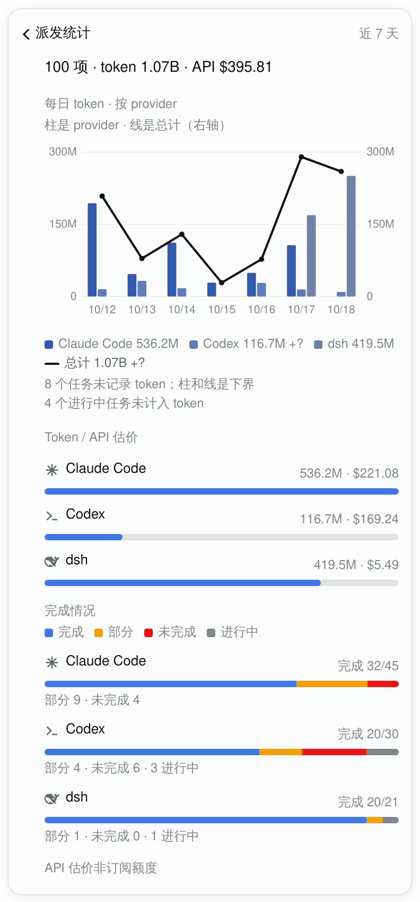

# Stats at the bottom, and a 7-day daily chart (2026-10-18)

kcn's fourth review had two parts: the stats tile sitting next to “recently ended” was odd, and
the stats layer deserved a multi-day chart — provider bars on the left, a total line on the right.
This note covers both, because moving the card and adding the chart changes the same surface.

## Where the tile sits

The stats card used to sit between recently ended and patrol. The queue is the panel's opening
view; a 7-day retrospective next to it read as if it were about the same list. The card is now the
**closing summary** of the whole task chip: after the patrol section and its coverage link, and
before the ops footer. The footer stays last deliberately — it is provenance metadata
(`ops <sha> · runner api N`), not content, and putting content below it would squeeze the footer
into the middle of the panel.

The card is not duplicated at the top. A second one-line summary would recreate the “stats next to
the queue” adjacency and make two stats surfaces to keep in sync. The cost is that the card is at
the end of a long panel; that is acceptable for a retrospective that is read after the queue, not
before it. If it turns out to be missed in practice, a single quiet link in the panel header is the
next option; a duplicate summary is not.

The card is still the one tappable summary (tasks, tokens, API estimate, completion bar) and it
still opens the existing detail layer, with the back bar and focus return. The lazy read is
unchanged: it starts on the panel's first open, through `taskStats`, never on the queue's 15s poll.

## The chart

Seven local days, one group per day, one bar per provider, and one total line on the right axis.

- **The measure is tokens.** Not tasks, not dollars. The title, the axis labels and the legend all
  say token. The API estimate remains a separate column in the page and its own footnote; it is
  never mixed into the bars or the line.
- **The line is the bars' sum.** `statsSeries` builds each day's `total` by adding that day's
  provider token values, and the line's points read `day.total`; there is no second aggregation.
  The seven line points therefore always equal the seven stack/group sums, and the page's card
  total is the sum of those points.
- **Grouped, not stacked.** Grouped bars keep each provider's own length readable; a stacked bar's
  top already is the total, so a separate total line would just trace the stack and make the right
  axis redundant. The grouped chart lets the line answer a different question (“how much in all?”)
  while each bar still answers “how much from this provider?”. Both axes are tokens; the left is
  per-provider, the right is the total, and the subtitle says so.
- **Empty days are 0, explicitly.** All seven dates are labelled; a day with no task has no bar
  and a line point at the baseline. Nothing is skipped, so a gap cannot be read as “no data” or as
  a day outside the window. The chart note says “{n} days had no task, drawn as 0”.
- **Unknown is not 0.** A provider-day with terminal tasks whose `TOKENS_TOTAL` was empty gets a
  `+?` in the legend and a lower-bound note; the bar is the known tokens, not a fabricated 0. A
  separate note counts live tasks, which are tasks but not yet tokens.
- **Seven days, not thirty.** The stats surface has always been the last seven days
  (`STATS_DAYS = 7`); the chart follows it. More days would make the 300px-wide popover a comb of
  hairlines. A 30-day view belongs in the full stats page/CLI, not this popover.

The data path is the existing one:

1. `task_queue_ops.py summary` loops the task directories once. For each task it already reads
   `meta.env` and `result.env`; it now also increments a `daily[date][agent]` bucket with
   `tasks`, and — only for a terminal task — `tokens` or `unknown`. The same frozen
   `result.env` numbers feed the aggregate and the bucket; no session is reread, live tasks add no
   tokens, and patrol rounds stay out unless `--all` is passed.
2. `readStats` validates the optional `daily` object and adds it to `TaskStats`. If the ops entry
   is older and has no `daily`, the field is absent and the chart is simply not rendered; the card
   and the two existing tables still work. If the field is present but malformed, the whole stats
   read is unavailable rather than drawing a made-up chart.
3. `statsView` fills every date in the window (including quiet ones), assigns the provider order,
   and computes `maxProvider`/`maxTotal` for the axes. The chart is pure SVG in `client.ts`; there
   is no chart library and no second RPC.

## Colour

Provider is a category, not a state: a provider is not “running” or “warning”. The dashboard theme
does not expose the design system's `--viz-*` chart palette to the dsh plugin (the screenshot
confirmed the tokens resolve empty), so the plugin defines a **local cool run** derived from the
business blue and the ink ladder:

| Token | Value | Use |
|---|---|---|
| `--tq-series-1` | 72% business blue + 28% ink | first provider |
| `--tq-series-2` | 52% business blue + 48% ink-3 | second provider |
| `--tq-series-3` | 28% business blue + 72% ink-3 | third provider |
| `--tq-series-4` | ink-3 | fourth provider |
| `--tq-series-5/6` | deeper/lighter blue–ink mixes | overflow, if a host ever has more |
| `--tq-series-total` | `--tq-ink` | the total line and its legend |

No hex, no hand-picked pastel, and no provider is the raw state token: even the first series is a
blue–ink mix, not `--tq-run` itself. The provider colours are separated by lightness, like the design
system's cool run; the total line is the strong neutral, not a seventh series. The page's completion
bars below keep their semantic state colours; the chart's categorical bars are intentionally a
different vocabulary and the legend names every one.

If dsh later exposes `--viz-*`, the six local declarations can be replaced with those tokens and
nothing else changes. Until then this is the honest fallback, and it is written once on `.pbc`.

## Motion

None on the chart itself. It is a reading, not a transition: the page swaps in immediately (the same
navigation behaviour as a task detail), and the bars and line appear at their real values. There is
no count-up, no draw-on animation, and no hover easing; a figure is never tweened. The stats card
keeps its existing press/focus behaviour, which respects `prefers-reduced-motion`.

## Alternatives

- **Stacked bars + total line on the same axis.** Rejected: the line would trace the stack top, and
  the right axis would be redundant; the chart would spend ink saying the same thing twice.
- **One shared axis.** Rejected: the total is three providers' sum, so the individual bars would be
  compressed into the bottom third, which is worse for the provider comparison the chart is for.
- **A second measure on the right axis (tasks, dollars).** Rejected outright: the bars and the line
  must be the same measure, and tasks/tokens/dollars must not be mixed in one plot.
- **A top summary plus the bottom card.** Rejected: duplicate stats surfaces, and the queue/stats
  adjacency returns. A single header link is the later option if discovery is a problem.
- **Put the card below the ops footer.** Rejected: the footer is metadata and belongs last.
- **A separate route instead of the layer.** The stats layer already has the back bar, focus return
  and surface; a route is a larger app change, not this PR.

## Captures

- **`task-chip-patrol-stats.png`** is a real WebKit render of this branch's `lib/client.js` on the
  live dsh, with the chart data frozen from the live task directories through the new
  `task_queue_ops.py summary` at 2026-10-18 18:30 HKT. The installed dsh host half is still #3060
  and does not serve `daily`; this is a preview of the new host half, **no install or restart was
  run**. The panel/patrol screenshots use the frozen queue from 17:06; the stats card is a later
  lazy read, as it is live.
- **`task-chip-patrol-panel.png`** and **`task-chip-patrol-summary.png`** show the card at the
  bottom of the panel, after patrol and before the ops footer. The previous position (between
  recently ended and patrol) is visible in the v2 full-panel capture at commit `8846441`; this note
  does not duplicate it.
- The daily numbers are real, not a schematic; the only schematic in this PR remains the coverage
  page's open-count variant, which is labelled in the patrol note.
