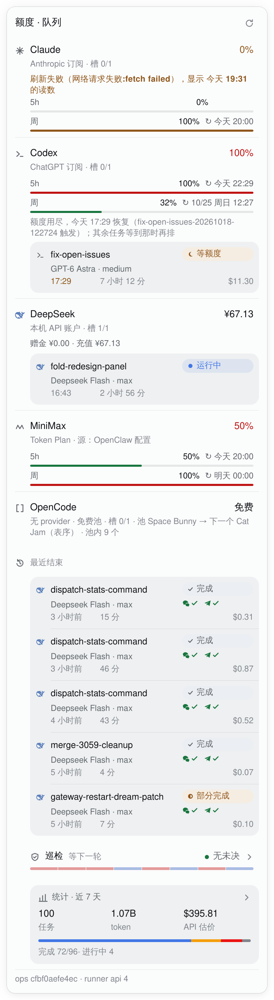
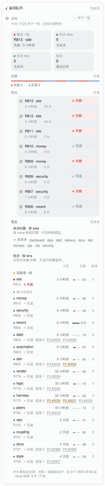
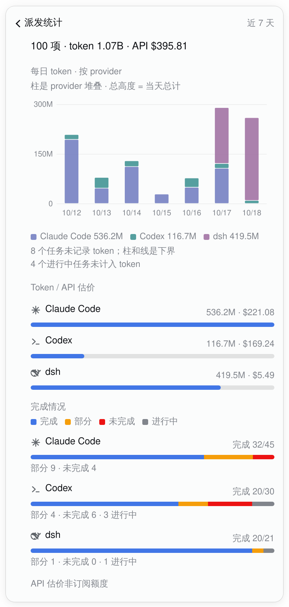

# The task chip: queue, patrol page and stats

The dsh sidebar chip is the main view of the agent-dispatch queue. It answers
three questions in order: what is running now, what did the patrol
find, and what did the last seven days cost. The chat command
`/dispatch-stats` prints the same frozen numbers without the queue and
allowances.

The panel reads the queue through `ops/host/task_queue_ops.py`; the task
detail's steering actions (cancel, priority, model, retry, wrap-up, deadline,
attempts, resumes) are its only writes and go through the same ops entry. The
chat mirror is read-only.

## The panel

From top to bottom:

- **allowances** — one row per provider and agent, with its window bars and
  resets; keys come from the gateway config's `env`, then the environment;
- **the queue** — each agent's live tasks, then recently ended tasks with their
  delivery receipts and cost;
- **the patrol entry** — one button, described below;
- **the stats card** — one lazy seven-day summary;
- **the ops footer** — provenance only (`ops <sha> · runner api N`), always last.



The queue polls every 15 seconds. The stats card and the patrol page do not:
their reads fire when the panel or the detail layer opens, and a late answer
after closing is dropped.

### The patrol entry

One button, the only patrol control in the panel:

- line 1: the shield, **巡检**, the live phase (`等下一轮`), and the coverage
  conclusion on the right (`无未决` green / `N 个 area 有未决` amber /
  `未决数未知` warn);
- line 2: a **4px strip** of the last eight round outcomes, newest first, one
  segment per round, using the same 35% verdict tints as the page's 6px strip;
- the strip is inside the button (`aria-hidden`, no separate target, no counts).
  The whole row is one hit area of at least 44px, one focus ring, one click;
- the accessible name is `巡检 · {phase} · {conclusion} · 打开巡检详情`.

### The stats card

The card is the closing summary, after patrol and before the ops footer: task
count, tokens, API estimate and a completion bar at a glance. Tapping it opens
the chart layer with the same back bar as the patrol page.

It is a lazy `taskStats(days, since, patrol)` read, once per panel open or
manual refresh. On a host whose half predates the method, the card is absent
and the queue is unaffected. The numbers are the frozen `result.env` values
each task wrote when it ended; a task continuing the same session is not
counted twice.

## The patrol page

The patrol entry opens the existing detail layer (back bar, focus return,
Escape, no new route). The page opens with a **2×2 KPI grid**: latest round
(name and verdict), open areas, open lenses, and the number of host round
records. Below it are three sections:

1. **结果** — a 6px outcome strip and its `失败 N · 完成 N` counts;
2. **轮次** — every round the host sent (at most eight), newest first;
3. **覆盖** — the area table (neutral magnitude bars, amber open-count badges,
   the green none-open line) and the lens ledger (two bands, status dot,
   neutral runs bar, open badge), plus the short caveats and the provenance
   footer.



The area table maps open issues by their labels; it is not code coverage. The
lens ledger keeps failed and interrupted runs in the record and prints the
open count separately. Closing the layer returns focus to the entry.

## The chart layer



Seven local days, one **stacked** bar per day, one provider per segment, one
left axis. Stacking makes the total the bar's height by construction: there is
no total line and no right axis. The seven heights add to the card's token
total. A day with no task is a real `0` and is labelled as such when one exists;
a provider with a recorded zero-token day keeps a 0-high segment instead of
disappearing from the legend.

The measure is tokens. The API estimate stays in the table below with its
`API 估价非订阅额度` note and never in the bars. Completion bars below use the
semantic state colours (done blue, partial amber, unfinished red, live grey),
each with its word and count; a provider colour never fills a state chip and a
state colour never fills a provider segment. The chart's legend names every
provider.

The seven days are all the card shows; wider windows (`30d`, `all`) belong to
`/dispatch-stats`. An older ops entry without the per-day buckets still returns
the card and the existing tables, just no daily chart.

## Numbers the views share

`task_queue_ops.py summary` reads only what each ended task froze in
`result.env` (`TOKENS_TOTAL`, `COST_USD`). It never rereads a session, so a
later task continuing the same session is not double-counted.

- **Live tasks** count in the task total and as `进行中`; they stay out of token
  and cost totals.
- **Tokens unknown** is an empty record, not `0`; a whole unknown cell reads
  `—`, and the CLI summary still reports the count.
- **Cost unpriced** is a model with no price row; its cell is `—`, not `$0`.
- **`free`** is counted apart (the opencode free pool).
- **`COST_USD` is an API list-price estimate**, not subscription quota spent.
- **A mixed-provider total is USD**: the per-provider rows keep their display
  unit, while the card's total sums the canonical USD estimates and reads a
  compact amount (e.g. `$101`; exact `≈ $100.86` in its title; never `多币种合计`). `costUsdEstimate`/`COST_USD` are already USD;
  the `¥` on a dsh row is a display unit, not a second-conversion input.
- **Patrol is excluded by default**; the window says `全部（含巡检）` when it is
  included.

The table's `完成/已结束` and `未完成` are the model's `DONE`/`PARTIAL`
outcomes and the remainder. Rows add up to `已结束`; the count of unknown and
unpriced entries is what the CLI summary reports.

## `/dispatch-stats`

The command prints one five-column table. The title carries the total and the
live count; there is no trailing description:

```
# 派发统计 · 近 7 天 · 92 项（进行中 2）

| Agent | 完成/已结束 | 部分 | 未完成 | token · API 估价 |
|---|---|---|---|---|
| Claude Code | 32/45 | 9 | 4 | 536.2M · $221.08 |
| Codex | 19/29 | 4 | 6 | 107.5M · $156.08 |
| dsh | 15/16 | 1 | 0 | 181.6M · $2.84 |
| 合计 | 66/90 | 14 | 10 | 825.3M · $380.00 |
```

`7d`/`30d`, `all`, `YYYY-MM-DD`, `patrol` and `plain` are one argument each;
anything else returns the usage line and never reaches the ops entry. `plain`
replaces the table with one token-share bar per agent for clients that show
pipes. The WeChat channel passes tables through as text, so the table is the
default; the client's own rendering decides how it looks.

## Colour, motion and accessibility

- Outcome verdicts use the state tokens: green complete, red failed, blue
  interrupted, grey no record. The page's outcome strip is the only animated
  data mark — one 240ms left-to-right reveal on mount; the entry strip and KPI
  tiles are static, and reduced motion shows the final strip.
- Provider categories in the chart use the brand hues at one muted band
  (lightness 0.60–0.62, chroma 0.06–0.10, 90% tint). They are category tokens,
  not semantic state tokens; the dsh whale uses the same brand token through
  `currentColor`. A future theme that brings the bands too close should
  desaturate the brand token, never move the state token.
- Hover is gated to fine pointers; targets are at least 44px; the focus ring
  and the return focus are shipped; the panel and layers work at a 390px
  bubble width.

## Where it lives

| Piece | Owner |
|---|---|
| panel, entries, layers, chart | `examples/dsh/packages/clawock-dsh/src/client.ts` (built into `lib/client.js`) |
| view model and text | `src/panel.ts`, `src/text.ts`, `lib/chat.js` |
| frozen totals and daily buckets | `ops/host/task_queue_ops.py summary` |
| panel/chat parity and the chart | `tests/decision_studio_plugin.spec.js` |
