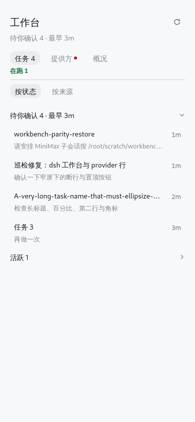
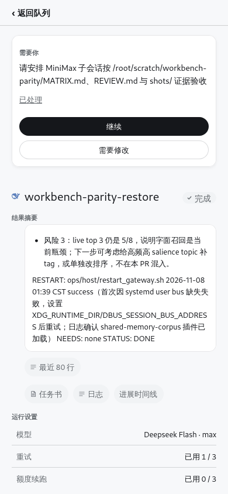
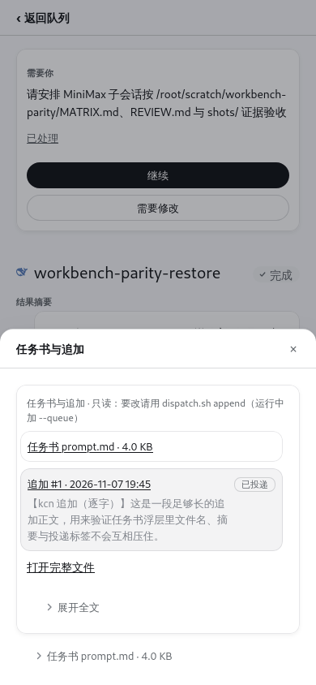
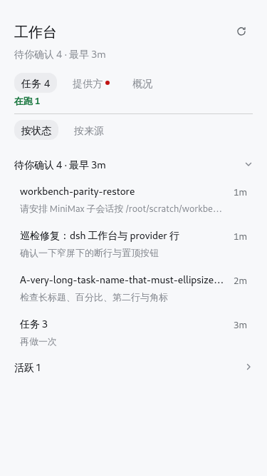
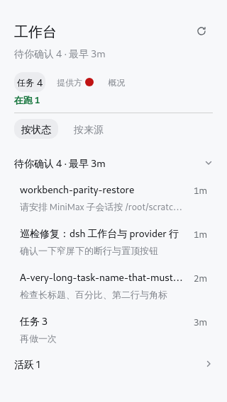

# Workbench host conformance (2026-11-08)

kcn's review: "你让参考dsh原生那个automation tasks那个plugin来实现吧
我觉得css完全可以重新做啥的？"

This page records the **measured** host reference, the new Workbench
baseline, what matches, and what is still intentionally different. The
reference is dsh's Automation tasks plugin
(`dsh-client-ui-schedule/lib/client.js`); its CSS is inline in the bundle
(`TaskManagerPage.module.css`), and the values below were also read back
from the live DOM with `getComputedStyle` at 390x844.

## Measured host (Automation tasks)


| Host element | Measured value |
|---|---|
| Page content | `padding: 0 20px 48px` at <=767px; width 960px max |
| Page heading | `padding-top: 28px; margin-bottom: 24px`; h1 **20px / 28px / 500**; left **20px** |
| Header action "New" | 32px high, padding 0 12px, radius 16px, 13px/20px, primary black |
| Filter tabs (Enabled/Paused/Ended/All) | 28px high, padding 0 10px, radius 14px, 14px/22px; selected background `--dsw-alias-interactive-bg-hover`; gap 12px |
| Search field | 36px high, radius 12px, 0.5px border, 14px input |
| List row | padding **8px**, gap 12px, radius **12px**, no divider; list gap **2px**; row title **14px/23px/500**; summary **13px/21px**, tertiary |
| Empty | centered, padding 48px 20px, 14px/22px tertiary; action 44px high |
| Detail pane | border-left .5px, gutter 24px, 14px/1.6 body |

## Token layer (the only source)

`styles.module.css` now ends in a closed Workbench layer, opened by
`/* wb-tokens:start */`. Everything below the closing marker may name a
token, never a raw value; `tests/workbench_tokens.spec.js` fails on a bare
`px` or `#hex` there. The values below are the host's (Automation tasks
source + live computed styles measured for #3306); none are invented.

| Group | Tokens | Value |
|---|---|---|
| Spacing | `--wb-space-1 … -7` | **4 / 8 / 12 / 16 / 20 / 24 / 32** |
| Type | `--wb-font-*` + `--wb-line-*` | **13/20** body, **14/22** UI, **20/28** page title, **13/21** meta; host row title **14/23**, small **12/18**, label **11/16** |
| Radius | `--wb-radius-sm/md/lg` | **8 / 12 / 16** |
| Surfaces | `--wb-surface-{flat,raised,sheet}-{bg,border,shadow}` | flat = `--dsw-alias-bg-base` + `border-l1` + none; raised = `bg-layer-1` + `border-l2` + `--dsw-shadow-lv1`; sheet = `bg-layer-2` + `border-l3` + `--dsw-shadow-lv3` |
| Text | `--wb-text-1 … -3` | `--dsw-alias-label-primary / secondary / tertiary` |
| Dividers | `--wb-line-1 / -2` | `--dsw-alias-border-l3 / l4` |
| Geometry | `--wb-row-h`, `--wb-btn-h`, `--wb-tab-h`, `--wb-group-h`, … | **62 / 32 / 28 / 36** (host measured) |

Light/dark backgrounds resolve through the host aliases: base `#fff` /
`#151517`, layer-1 `#fff` / `#232324`, layer-2 `#fff` / `#2c2c2e`; the
host's border ladder is `#0000000a/1a/1f/29` light and
`#ffffff0f/1f/29/33` dark. The plugin therefore never paints its own
surface colour.

## Primitives (pages only compose)

`src/workbench-primitives.ts` owns the class mapping and the one value set
per primitive. The four converted surfaces are Workbench Home (queue),
task detail, History and the brief sheet; a page may choose layout, not a
height, padding, radius or type value.

| Primitive | Canonical class | One value | Used by |
|---|---|---|---|
| `Row` | `.wb-row` (`.wb-hist-row` alias) | 62px high, 8px inset, 12px gap, radius 12; title 14/23/500, meta 13/21 | queue, History |
| `SectionHeader` | `.wb-group` / `.tq-d-sec-title` | 36px band, 14/22/500, chevron right | queue groups, Overview entries, detail section headings |
| `Button` | `.wb-act` / `.tq-pill` | 32px high, 0 12px, radius 16, 13/20; primary / secondary / ghost / danger | needs actions, detail pills, sheet close |
| `Chip` | `.wb-ov-chip` | 20px high, 0 8px, radius 8, 11/16 | patrol status, counts |
| `Card` | `.wb-card` / `.tq-d-summary` | raised surface, 12px pad, radius 12 | needs block, recorded ack, closing summary |
| `Sheet` | `.wb-sheet` | sheet surface, 16px top radius, 48px head, max 82% | brief / log / timeline / picker |
| `Field` | `.tq-d-field` | 8px vertical, label 13/21 secondary, value 13/20 primary | every detail field |
| `EmptyState` | `.wb-empty` | 48/20 pad, centered, 14/22, 44px action | empty queue, empty Providers, empty detail |

The queue/history row, detail pill and sheet close now resolve to the same
measured values: `workbench_overlap.spec.js` prints the cross-page
`PRIMITIVE` checks (Row 62/62 at 390 and 375, SectionHeader 36/36, Button
32/32 at 390/375/320) and fails if they differ.

| Workbench element | New value | Host value | Status |
|---|---|---|---|
| Page inset | **20px** | 20px | matched |
| Title | **20/28/500**, left 20 | 20/28/500, left 20 | matched |
| Subtitle | 14/22, tertiary | (host has no subtitle) | host rhythm |
| Tabs | **28px, 0 10px, radius 14, 14/22**, gap 12 | filter tabs 28/10/14/14/22 | matched visual; view tabs |
| Count in tab | inline `4` at 14px | host tabs have no count | intentional difference |
| Group header | **36px, 14/22/500** | (host list has no group) | host rhythm |
| Task row | **8px pad, 12 gap, radius 12**, 62px; title 14/23/500; meta 13/21 | identical | matched |
| Row left text | **28px** (20 + 8) | 28px | matched |
| Primary/secondary buttons | **32px, radius 16, 13/20** | 32/16/13/20 | matched |
| Detail pills | **32px, radius 16, 13/20** | host action 32 | matched (was 28) |
| Empty | centered 48/20, 14/22, action 44px | identical | matched |
| Provider alert | 6px red dot | host alert dot | matched shape |
| History rows | same `Row` primitive (62px) | host row | matched |
| Search field | none | 36px field | **difference** (no search surface) |
| Detail body | 13/20, gutter 20px | 14/1.6, gutter 24px | close, not identical |
| Providers data table | name/meta + 4px bar | no host analogue | custom data surface |

## Raw-value gate (before → after)

The gate counts the Workbench layer only: the older Decision Mind dashboard
above the marker has its own frozen values and its own type contract, and is
not part of this surface.

| Count | Before | After |
|---|---|---|
| Bare `px` in the Workbench layer | **323** (322 outside the old token block) | **0** |
| Bare `#hex` in the Workbench layer | **7** (4 outside) | **0** |
| Raw values in the whole `styles.module.css` | 942 `px` / 59 `hex` | token blocks only |

`node tests/workbench_tokens.spec.js` is the gate; it also asserts the three
surface tiers, the three text levels, the two divider levels, the four host
type pairs and that each primitive class is written only by the primitive
module.

## Pixel diff against the host

`workbench_overlap.spec.js` renders the same task row twice at 320/375/390/
1440: once from the real bundle, once from a host reference built from the
measured Automation row CSS, with the same title/sub/age text and width. It
compares PNG pixels (channel delta > 24/255). Measured: **0 / 21,700**
pixels at 390, **0 / 20,770** at 375, **0 / 17,360** at 320 and **0 / 18,538**
at 1440 in both themes. The gate fails above **1.0%**; that allowance is only
for platform font rasterisation and is far below a one-pixel
padding/line-height shift (thousands of pixels).

## Left edges (measured)

`--wb-pad` is 20px at 390/375/320 (the host's mobile content inset). Page
chrome starts at 20; row text starts at 28 because the host row itself has
8px padding. The `header` gauge asserts:

```text
390: title 20 · subtitle 20 · tabs 20 · group 20 · row 28
375: title 20 · subtitle 20 · tabs 20 · group 20 · row 28
320: title 20 · subtitle 20 · tabs 20 · group 20 · row 28
```

Earlier the page had 44/16/12 baselines; that is gone.

## Screenshots

| Width | Home | History | Detail | Brief sheet | Dark |
|---|---|---|---|---|---|
| 390 |  |  |  |  |  |
| 375 |  | (same Row, 62px) | (same) | (same) | (same tokens) |
| 320 |  | (same) | (same) | (same) | (same tokens) |

## What is still different

1. No search field (the Workbench has no search data flow; adding one
   would be a new feature, not CSS).
2. The tab count is inline text; Automation's tabs carry no count.
3. Detail body is 13/20 with a 20px gutter vs the host detail's 14/1.6
   with 24px; the Workbench detail is a full-page focus layer, and the
   tighter reading line is retained for the long closing reports.
4. Provider rows are a data table (name, balance, bar) with no direct
   host analogue; they follow the same row radius/padding/type.

The functional contracts from the 2026-11-08 fixes remain: UTF-8
fetch+TextDecoder+blob previews, single-column brief, History ¥/$ and
"latest 5", Dismiss ack, rendered Markdown, the G1 generic-scan negative
control, the G2 Log note, and the G3 doc correction.

## Related

- [`workbench-geometry.md`](workbench-geometry.md)
- [`workbench-type.md`](workbench-type.md)
