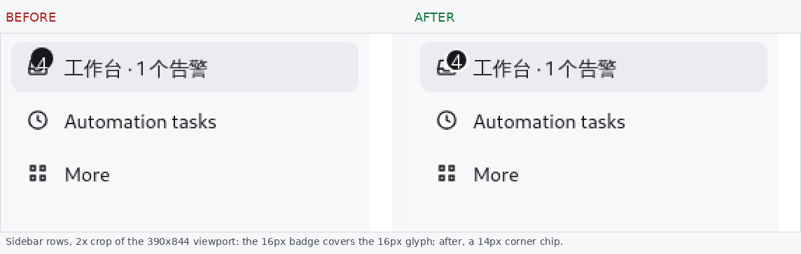
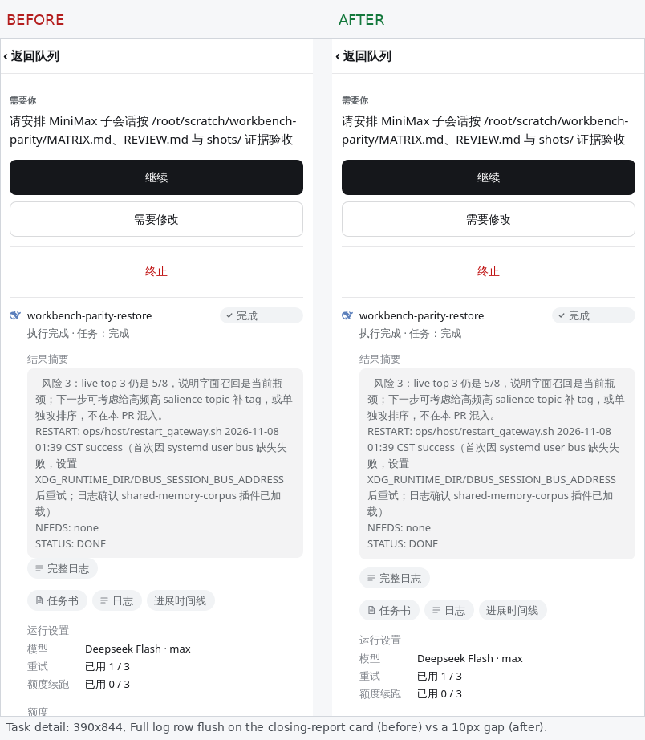

# Workbench geometry on a phone

The live dsh host draws `sidebar.panellist` rows as 36px buttons (measured
2026-11-08 at 402x874 and 390x844) with an 18px glyph slot, a 14px/22px
label and a 2px gap. The rail is the same list at 56px with 36px hit boxes
and a 12px gap. The Workbench entry is a 16px glyph inside that slot; its
count and alert marks therefore belong to the glyph's own box, not to the
host wrapper (which can be 18px, 36px or 48px depending on the host build).

## Contracts pinned by `tests/workbench_overlap.spec.js`

- **Sidebar rows** (390x844 and 375x667, host-like fixture): four adjacent
  rows stay 36px and do not intersect; the label, glyph, count badge and
  rail alert each stay inside their row. The count badge covers at most 40%
  of the glyph, and the badge and the alert never intersect.
- **Closing report** (390x844, 375x667, 320x568, desktop): the Full log row
  clears the report card by at least 8px; the card clips neither its last
  line nor its width.
- **Patrol coverage** (390x844 and 375x667): the two tables stack in one
  column and neither overflows horizontally. The old three-column layout
  must not come back on a phone.
- **Providers** (390x844, 375x667, 320x568, dark): a name, its primary and
  secondary values, and the meta row's two ends never intersect; no row
  overflows horizontally.

The `sidebar-legacy` state replays the pre-fix badge CSS as a negative
control, so the detector cannot quietly stop seeing the defect.

## Evidence

The screenshots are WebKit at 390x844 with the real bundle and the
host-like 36px sidebar; the after column is the fixed bundle.

